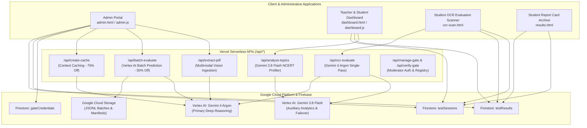

# NerdTutors Master System Index & Architectural Blueprint

> **System Version:** 2.58 | **CBSE Standards:** Class 10th & Class 12th Commerce  
> **Infrastructure:** Vercel Serverless + Google Cloud Vertex AI + Firebase Firestore  
> **Documentation Directory:** [`docs/system/`](file:///d:/Trinno/NerdTutors/docs/system/)

---

## 1. High-Level Architecture Map

NerdTutors is an institutional-grade, AI-powered examination evaluation, performance matrix, and analytics platform. It replaces manual human marking for subjective and objective board exams with Google Gemini frontier multimodal models, rigorous academic research guardrails, and real-time Firestore persistence.



---

## 2. Master Documentation Index (`docs/system/`)

| Section | Documentation Path | Primary Scope & Governed Files |
|---|---|---|
| **01** | [`docs/system/01-admin-portal.md`](file:///d:/Trinno/NerdTutors/docs/system/01-admin-portal.md) | **Admin Portal, Batch Evaluator, PDF Ingestion Hub & Gate Registry**<br/>• `admin.html`, `admin.js`, `js/admin-modules/*`<br/>• Session CRUD, cascading deletes, orphaned cleanup, PDF.js + Vision extraction, Google Batch API integration, JSZip bulk packaging. |
| **02** | [`docs/system/02-dashboard-analytics.md`](file:///d:/Trinno/NerdTutors/docs/system/02-dashboard-analytics.md) | **Dashboard, Longitudinal Progress & Question Matrix**<br/>• `dashboard.html`, `dashboard.js`, `js/matrix-manager.js`, `js/student-progress-chart.js`<br/>• SVG vector trendline, natural question sort (`naturalQuestionSort`), threshold colors, leaf-level NCERT topic cards, layout switcher. |
| **03** | [`docs/system/03-evaluation-ocr-engine.md`](file:///d:/Trinno/NerdTutors/docs/system/03-evaluation-ocr-engine.md) | **Evaluation & Multimodal OCR Grading Engines**<br/>• `ocr-scan.html`, `results.html`, `api/ocr-evaluate.js`, `api/cbse-rules.json`<br/>• Mobile dual-input upload bug resolution, Gemini 4 Argon single-pass vision, deterministic seed 42, binary MCQ hard-lock, Defend/Refute stance cap, in-place re-evaluation. |
| **04** | [`docs/system/04-serverless-apis.md`](file:///d:/Trinno/NerdTutors/docs/system/04-serverless-apis.md) | **Serverless Backend APIs & Background Systems**<br/>• `api/analyze-topics.js`, `batch-evaluate.js`, `create-cache.js`, `extract-pdf.js`, `manage-gate.js`, `verify-gate.js`<br/>• Shared Vertex AI authentication (`vertex-auth.js`), Google Context Caching (75% discount), Batch prediction lifecycle, key rotation, deep regex secret redaction. |
| **05** | [`docs/system/05-firestore-data-models.md`](file:///d:/Trinno/NerdTutors/docs/system/05-firestore-data-models.md) | **Firestore Database Persistence & Data Integrity Invariants**<br/>• `firebase-config.js`, all Firestore client/server interactions<br/>• Collection schemas (`testSessions`, `testResults`, `gateCredentials`, `batchJobs`), cascading delete invariants, in-place update invariants, orphaned data detection. |

---

## 3. Master Component & DOM Inventory

### 3.1 Client Pages & Scripts Mapping

```
NerdTutors Root
├── admin.html / admin.js
│   ├── js/admin-modules/session-manager.js  ── Exam Session CRUD, Cascading Delete, Reports, CSV
│   ├── js/admin-modules/pdf-extractor.js    ── PDF.js Engine 1 + Gemini Vision Engine 2, Diagnostics
│   ├── js/admin-modules/bundle-evaluator.js ── Student Segmenting, Canvas Compression, Google Batch API
│   ├── js/admin-modules/gate-manager.js     ── Firestore gateCredentials Registry & Shift Tool
│   ├── js/admin-modules/admin-utils.js      ── CBSE Class/Subject Dynamic Synchronization, Toasts
│   └── js/admin-modules/question-manager.js ── Legacy Question Bank Management
│
├── dashboard.html / dashboard.js
│   ├── js/student-progress-chart.js         ── Longitudinal SVG Trendline, Exam Filter Chips, KPI Strip
│   ├── js/matrix-manager.js                 ── Question-by-Student Performance Matrix & Topic Diagnostics
│   └── dashboard.css                        ── Sticky Coordinates, Responsive Breakpoints, Matrix Themes
│
├── ocr-scan.html                            ── Mobile-safe Camera Capture, Single-Pass Vision Grading
└── results.html                             ── Student Report Cards, Narrow-Margin Print Stylesheet
```

### 3.2 Primary DOM Element Quick Reference

| DOM Identifier | Page Location | Purpose & Action |
|---|---|---|
| `#sessionManageTableBody` | `admin.html` | Renders published test sessions with caching, edit, toggle, and delete actions. |
| `#resultSessionSelect` | `admin.html` | Test session selector for results table, including `__ORPHANED__` evaluations. |
| `#btnCleanOrphanedData` | `admin.html` | 1-click bulk purge trigger for leftover student evaluations from deleted tests. |
| `#resultsActionsBar` | `admin.html` | Houses bulk PDF export, ZIP packaging (`#btnDownloadZipReports`), and CSV export. |
| `#bundleStudentsContainer` | `admin.html` | Houses dynamic multi-page student segments in Batch Evaluator. |
| `#btnSubmitBatchJob` | `admin.html` | Dispatches asynchronous Vertex AI Batch Prediction job. |
| `#progressPlot` | `dashboard.html` | Container for SVG trendline overlay and longitudinal exam bars. |
| `#progressSubjectTabs` | `dashboard.html` | Filter pills by subject (`Economics`, `Business Studies`, `Accountancy`). |
| `#progressExamChips` | `dashboard.html` | Interactive comparison toggle chips (`✓` active, `+` excluded). |
| `#questionMatrixTable` | `dashboard.html` | Sticky 2D grid of questions (rows) vs students (columns). |
| `#matrixCellDrawerBackdrop` | `dashboard.html` | Slide-over drawer displaying student OCR text and examiner evaluation. |
| `#fileInput` / `#cameraInput` | `ocr-scan.html` | Decoupled inputs resolving mobile OS multi-file camera bug. |
| `#btnReevaluate` | `ocr-scan.html` | Re-evaluates student paper in-place (`updateDoc`) without duplicate records. |

---

## 4. AI Model Architecture & Tier Hierarchy

NerdTutors strictly isolates AI responsibilities across models to balance cognitive frontier reasoning with latency and cost:

```
┌────────────────────────────────────────────────────────────────────────┐
│                        AI MODEL HIERARCHY MATRIX                       │
├──────────────────────┬────────────────────────┬────────────────────────┤
│ Model                │ Primary Tasks          │ Configuration & Rules  │
├──────────────────────┼────────────────────────┼────────────────────────┤
│ gemini-4-argon       │ Primary Exam Grading   │ • Direct Single-Pass   │
│ (Frontier Deep       │ (/api/ocr-evaluate)    │ • temp: 0.0, seed: 42  │
│  Reasoning Vision)   │ Direct PDF Ingestion   │ • thinkingLevel: medium│
│                      │ (/api/extract-pdf)     │ • mediaResolution: HIGH│
│                      │ Batch Evaluation       │ • Latency: ~8-14s      │
│                      │ (/api/batch-evaluate)  │ • Cost: ~₹3.00 / paper │
├──────────────────────┼────────────────────────┼────────────────────────┤
│ gemini-3.8-flash     │ Failover Grading       │ • Direct Single-Pass   │
│ (High-Throughput     │ (/api/ocr-evaluate)    │ • temp: 0.0, seed: 42  │
│  Fast Reasoning)     │ NCERT Topic Analytics  │ • thinkingBudget: 512  │
│                      │ (/api/analyze-topics)  │ • Latency: <2s         │
└──────────────────────┴────────────────────────┴────────────────────────┘
```

### Cost Optimization Engines
1. **Google Context Caching (75% Token Discount)**: Pre-loads static exam questions, marking schemes, and subject directives via `/api/create-cache` with a 72-hour TTL.
2. **Google Vertex AI Batch API (50% Token Discount)**: Evaluates bulk student bundles asynchronously via `/api/batch-evaluate`, returning outputs written to GCS.

---

## 5. Academic Defense Layer & Grading Invariants

| Guardrail Rule | Code Enforcement | Document Reference |
|---|---|---|
| **Binary MCQ Hard-Lock** | MCQs dynamically locked to 0.5 or 1.0; wrong option letter forced to `0.0`. Fractional marks eliminated. | [`docs/system/03-evaluation-ocr-engine.md`](file:///d:/Trinno/NerdTutors/docs/system/03-evaluation-ocr-engine.md#41-dynamic-binary-mcq-hard-lock) |
| **Defend / Refute Stance Cap** | Incorrect stance on Defend/Refute statements is capped to a maximum of `1.0` mark. | [`docs/system/03-evaluation-ocr-engine.md`](file:///d:/Trinno/NerdTutors/docs/system/03-evaluation-ocr-engine.md#42-defend-vs-refute-stance-governance) |
| **Sum Recalculation Invariant** | Total score is programmatically calculated as $\sum \text{question scores}$ and clamped to $[0, \text{maxMarks}]$. | [`docs/system/03-evaluation-ocr-engine.md`](file:///d:/Trinno/NerdTutors/docs/system/03-evaluation-ocr-engine.md#44-deterministic-mathematical-clamping--invariant-sum-recalculation) |
| **15-Word Feedback Budget** | Question feedback strictly limited to 1 sentence (max 15 words); improvements capped at 2 bullet points. | [`docs/system/03-evaluation-ocr-engine.md`](file:///d:/Trinno/NerdTutors/docs/system/03-evaluation-ocr-engine.md#43-15-word-feedback-budget--improvements-cap) |
| **Cascading Session Delete** | Deleting a `testSessions` document concurrently purges all matching `testResults` records. | [`docs/system/05-firestore-data-models.md`](file:///d:/Trinno/NerdTutors/docs/system/05-firestore-data-models.md#31-cascading-delete-invariant) |
| **In-Place Re-Evaluation** | Re-evaluating a student paper updates the existing document via `updateDoc`, preventing duplicate cards. | [`docs/system/05-firestore-data-models.md`](file:///d:/Trinno/NerdTutors/docs/system/05-firestore-data-models.md#32-in-place-re-evaluation-updatedoc-invariant) |
| **Class-Subject Invariant** | Class 10th locked to Social Science; Class 12th locked to Commerce (Economics, Accounts, BST). | [`docs/system/05-firestore-data-models.md`](file:///d:/Trinno/NerdTutors/docs/system/05-firestore-data-models.md#34-dynamic-class-subject-alignment-invariant) |

---

## 6. Catalog of Security Findings (Deferred to Phase 2)

Per user directive, code modifications and security patching were excluded from Phase 1. The following security surfaces have been audited and cataloged for implementation during **Phase 2 (Security Remediation)**:

1. **Firestore Client-Side Security Rules**:
   - *Current State*: Firestore rules are configured directly in the Firebase Console.
   - *Phase 2 Objective*: Provide a syntactically verified, production-hardened `firestore.rules` file restricting writes on `testSessions` and `gateCredentials` to authenticated administrators (`request.auth != null`), and validating payloads on `testResults`.
2. **Serverless Origin Whitelisting**:
   - *Current State*: Several endpoints (`api/analyze-topics.js`, `api/batch-evaluate.js`, `api/create-cache.js`) currently return wildcard CORS `Access-Control-Allow-Origin: *`.
   - *Phase 2 Objective*: Restrict accepted origins to approved production domains (`nerd-tutors.vercel.app`) and local development hosts.
3. **API Rate Limiting & Abuse Protection**:
   - *Current State*: Because gate restrictions were removed for direct access, endpoints lack request rate limiters.
   - *Phase 2 Objective*: Implement transparent, non-blocking rate limiting (e.g. 30 requests per minute per IP) to prevent token exhaustion without impacting normal exam sessions.
4. **Comprehensive Stored XSS Sanitization**:
   - *Current State*: Most display templates use `escapeHtml()`, but dynamic strings in legacy question modals and report cards must be systematically verified to prevent script injection.
