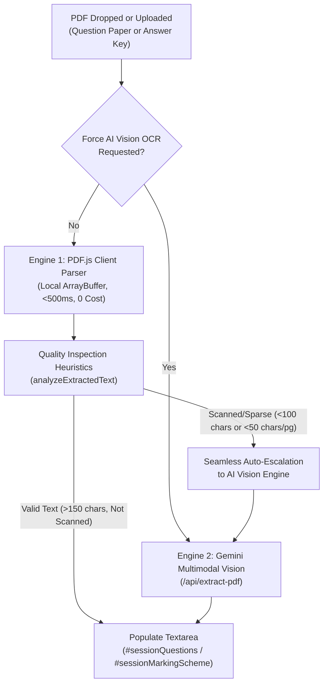
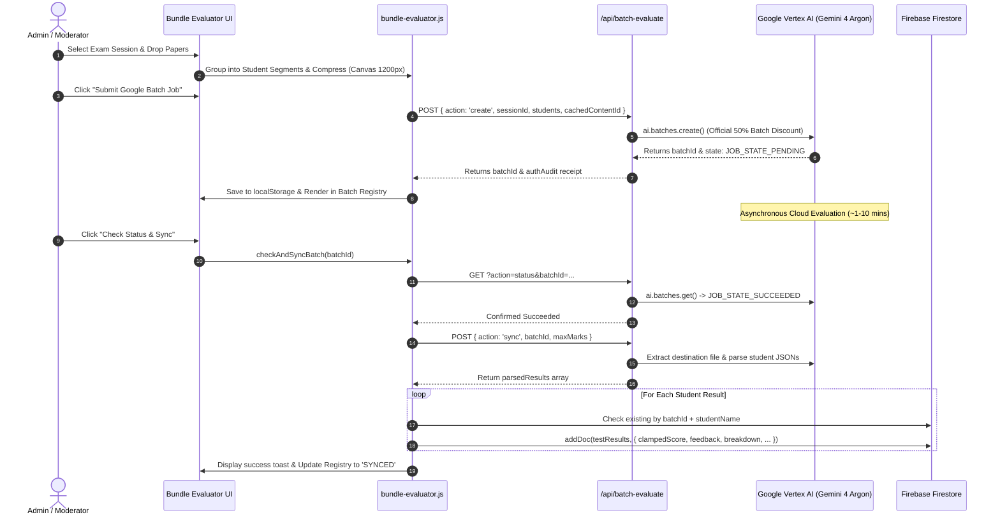

# NerdTutors Admin Subsystem Architecture Specification

> **Target Path:** `docs/system/01-admin-portal.md`  
> **Subsystem:** Admin Management Portal, Batch Evaluator, PDF Ingestion Hub & Security Registry  
> **Primary Components:** `admin.html`, `admin.js`, `js/admin-modules/*`

---

## Architecture Overview

```mermaid
graph TD
    subgraph UI_Layer ["Admin Presentation Layer (admin.html)"]
        AUTH["Authentication Gate<br/>(#loginContainer)"]
        NAV["Tab Controller<br/>(Tabs: create-session, view-results, evaluate-answers, bundle-eval, gate-keys)"]
        PANEL_SESS["Session Creator & Manager<br/>(#create-sessionTab)"]
        PANEL_RES["Results & Report Hub<br/>(#view-resultsTab)"]
        PANEL_EVAL["Manual PDF Evaluator<br/>(#evaluate-answersTab)"]
        PANEL_BUNDLE["Bundle Batch Evaluator<br/>(#bundle-evalTab)"]
        PANEL_GATE["Gate Key Manager<br/>(#gate-keysTab)"]
    end

    subgraph Module_Layer ["Core Modular Logic (js/admin-modules/)"]
        ORCH["admin.js<br/>(Orchestrator, Auth, Global Router)"]
        MOD_SESS["session-manager.js<br/>(CRUD, Cascading Delete, Caching, Reports)"]
        MOD_PDF["pdf-extractor.js<br/>(PDF.js Engine 1 + Gemini Vision Engine 2)"]
        MOD_BUNDLE["bundle-evaluator.js<br/>(Segment Grouping, Vertex AI Batch API)"]
        MOD_GATE["gate-manager.js<br/>(Firestore Collection 'gateCredentials')"]
        MOD_UTILS["admin-utils.js<br/>(Toasts, Modals, Class/Subject Sync)"]
        MOD_Q["question-manager.js<br/>(Legacy Question CRUD & Charts)"]
    end

    subgraph Backend_Cloud ["Backend Services & Cloud Infrastructure"]
        FS_TEST["Firestore: testSessions"]
        FS_RES["Firestore: testResults"]
        FS_GATE["Firestore: gateCredentials"]
        API_CACHE["/api/create-cache<br/>(Gemini Context Cache - 75% Off)"]
        API_EXTRACT["/api/extract-pdf<br/>(Gemini Vision OCR Fallback)"]
        API_BATCH["/api/batch-evaluate<br/>(Vertex AI Batch Prediction - 50% Off)"]
        API_GATE["/api/manage-gate<br/>(Credential Management & Sync)"]
    end

    AUTH --> ORCH
    NAV --> MOD_UTILS
    PANEL_SESS --> MOD_SESS
    PANEL_SESS --> MOD_PDF
    PANEL_RES --> MOD_SESS
    PANEL_BUNDLE --> MOD_BUNDLE
    PANEL_GATE --> MOD_GATE

    MOD_SESS --> FS_TEST
    MOD_SESS --> FS_RES
    MOD_SESS --> API_CACHE
    MOD_PDF --> API_EXTRACT
    MOD_BUNDLE --> API_BATCH
    MOD_BUNDLE --> FS_RES
    MOD_GATE --> FS_GATE
    MOD_GATE --> API_GATE
```



---

## 1. DOM Tabs, Main Containers, Modals & Element Inventory

### A. Authentication & Shell Containers
* `#loginContainer`: Admin login card with `#loginForm`, `#adminEmail`, `#adminPassword`, `.btn-submit`, and `#googleSignIn`.
* `#accessDeniedContainer`: Unauthorized access notice with `#deniedEmail` and reload button.
* `#adminContainer`: Authenticated workspace shell. Contains header with navigation buttons:
  * `#btnHeaderViewResults`: Direct jump to results tab (`data-tab="view-results"`).
  * Student Dashboard link (`dashboard.html` target `_blank`).
  * `#userEmail`: Dynamic user identity badge.
  * `#btnLogout`: Firebase sign-out button.

### B. Tab Navigation Bar (`.tabs`)
* `[data-tab="create-session"]`: **➕ Create Test Session** (Panel `#create-sessionTab`)
* `[data-tab="view-results"]`: **📋 View Results** (Panel `#view-resultsTab`)
* `[data-tab="evaluate-answers"]`: **📝 Manual PDF Evaluation** (Panel `#evaluate-answersTab`)
* `[data-tab="bundle-eval"]`: **📦 Bundle Evaluation** (Panel `#bundle-evalTab`)
* `[data-tab="gate-keys"]`: **🔑 Gate Access Keys** (Panel `#gate-keysTab`)

### C. Tab 1: Create Test Session (`#create-sessionTab`)
* **Session Metadata Form (`#createSessionForm`):**
  * `#sessionClass`: Select dropdown (`Class 10th`, `Class 12th`).
  * `#sessionSubject`: Dynamically populated subject select (CBSE sync).
  * `#sessionBatch`: Batch select (`Both`, `Nerd Tutors OSEM`, `Nerd Tutors Nalanda`, `Others`).
  * `#sessionName`: Text input for exam title.
  * `#sessionYear`: Exam year select (`2020`–`2026`, `Standard`).
  * `#sessionSet`: Exam set select (`Standard / All`, `Set 1`–`Set 4`, `custom`).
  * `#sessionCustomSet`: Text input displayed only when set is `custom`.
  * `#sessionMaxMarks`: Number input (`1`–`500`).
  * `#sessionQuestions`: Multi-line textarea for test questions.
  * `#sessionMarkingScheme`: Multi-line textarea for marking guidelines.
  * `#sessionOtherInstructions`: Highlighted textarea for superior grading commands / overrides.
  * `#btnCreateSession`: Submit button (`💾 Create & Publish Test`).
* **Direct PDF Ingestion Hub (`.pdf-extract-hub`):**
  * `#btnRunDiagnostics`: Button to trigger the 4-stage automated extraction self-test.
  * *Question Paper Card (`#questionPdfDropzone`):*
    * `#questionPdfInput`: Hidden file input (`.pdf`).
    * `#questionPdfEmptyState`: Default drag-and-drop placeholder.
    * `#questionPdfLoadedCard`: File info badge (`#questionPdfFileName`, `#questionPdfFileSize`).
    * `#btnChangeQuestionPdf`: Re-select PDF button.
    * `#btnRemoveQuestionPdf`: Clear file button.
    * `#questionPdfStatus`: Progress wrapper (`#questionPdfStatusText`, `#questionPdfQualityBadge`).
    * Action pills: `#btnExtractQuestionsFast`, `#btnExtractQuestionsAi`, `#btnClearQuestionsText`.
  * *Marking Scheme Card (`#schemePdfDropzone`):*
    * `#schemePdfInput`: Hidden file input (`.pdf`).
    * `#schemePdfEmptyState`: Default placeholder.
    * `#schemePdfLoadedCard`: File info badge (`#schemePdfFileName`, `#schemePdfFileSize`).
    * `#btnChangeSchemePdf`: Re-select scheme button.
    * `#btnRemoveSchemePdf`: Clear file button.
    * `#schemePdfStatus`: Progress wrapper (`#schemePdfStatusText`, `#schemePdfQualityBadge`).
    * Action pills: `#btnExtractSchemeFast`, `#btnExtractSchemeAi`, `#btnClearSchemeText`.
* **Published Test Sessions Management Table:**
  * `#sessionManageTableBody`: Target tbody for real-time Firestore session records.
  * Action Buttons per row:
    * `⚡ 75% Cached` / `⚡ Cache (75% Off)`: Context caching trigger (`window.cacheTestSession`).
    * `✏️ Edit`: Opens `#editSessionModal` (`window.editSession`).
    * `⏸️ Deactivate` / `▶️ Activate`: Status toggle (`window.toggleSessionStatus`).
    * `🗑️`: Cascading delete trigger (`window.deleteSession`).

### D. Tab 2: View Results (`#view-resultsTab`)
* Header Action Bar:
  * `#btnCleanOrphanedData`: Dynamic warning button appearing only when orphaned records exist.
  * `#btnPopulateMockData`: Development helper generating 2 test sessions and 10 student evaluations.
* Dropdown Selector:
  * `#resultSessionSelect`: Session dropdown populated dynamically with active sessions + `__ORPHANED__` option.
* Results Actions Bar (`#resultsActionsBar`):
  * `#resultsCountBadge`: Count pill (`#resultsCountText`) and session meta (`#sessionDetailsBadge`).
  * `#btnDownloadAllReports`: Unified page-separated printable layout for all students.
  * `#btnDownloadZipReports`: Bulk ZIP packaging engine creating standalone HTML cards.
  * `#btnExportSessionCSV`: CSV spreadsheet generator.
* Student Results Table (`#resultsTable`):
  * `#resultsTableBody`: Renders student rows with Name, Batch pill, Class, Subject, Score (with ✏️ edit pen), Date Taken, and action buttons:
    * `👁️ View Card` (`window.viewReportCard`)
    * `📥 PDF` (`window.downloadSingleStudentPdf`)
    * `🖨️ Print` (`window.printReportCard`)
    * `🗑️ Delete` (`window.deleteResult`)

### E. Tab 3: Manual PDF Evaluation (`#evaluate-answersTab`)
* Dual Upload Cards:
  * `#modelUploadArea`, `#modelFileInput`, `#modelFileInfo`, `#modelFileName`, `#btnRemoveModelFile`
  * `#studentUploadArea`, `#studentFileInput`, `#studentFileInfo`, `#studentFileName`, `#btnRemoveStudentFile`
* Settings & Triggers:
  * `#evalMaxMarks`: Total exam marks input.
  * `#btnStartEvaluation`: Evaluator submit button (enabled only when both files are selected).
  * `#evalLoading`: Loading spinner with elapsed status.
  * `#evalResults`: Results container with `#evalReportScore`, `#evalReportMax`, `#evalReportPct`, `#evalReportAppealContainer`, `#evalReportAppealPotential`, `#evalReportAppealSummary`, `#evalReportFeedback`, `#evalReportImprovements`.

### F. Tab 4: Bundle Evaluation (Batch Mode) (`#bundle-evalTab`)
* Step 1: Session Selection:
  * `#bundleSessionSelect`: Dropdown with sessions and max marks.
  * `#bundleCacheStatusWrap`: Context cache active banner (75% discount status).
* Step 2: Student Segment Cards:
  * `#btnAddStudentSegment`: Adds a dedicated student segment card.
  * `#btnQuickDropTrigger` & `#bundleFileInput`: Multi-file picker with auto-student grouping.
  * `#bundleEmptyDropZone`: Drag-and-drop ingestion zone.
  * `#bundleStudentsContainer`: Target container for dynamic student cards.
* Step 3: Queue Summary & Google Batch Dispatch:
  * `#bundleQueueCard`: Queue wrapper.
  * `#bundleQueueCountBadge`: Student, page, and payload size counter (`~X MB`).
  * `#btnClearBundle`: Empties the upload queue.
  * `#btnSubmitBatchJob`: Asynchronous Vertex AI dispatch button.
* Step 4: Batch Jobs Registry & Sync Panel:
  * `#batchJobsRegistryCard`: Persistent registry container.
  * `#btnRefreshBatchJobs`: Polls live Vertex AI status and Firestore metadata.
  * `#batchJobsListContainer`: Renders reverse-chronological batch cards.

### G. Tab 5: Gate Access Keys (`#gate-keysTab`)
* Actions & Statistics:
  * `#btnShiftToFirebase`: Direct Firestore push button (`window.shiftCredentialsToFirebase`).
  * `#gateFirestoreRulesNotice`: Notice card with security rule copy snippet.
  * Metric counters: `#gateTotalKeysCount`, `#gateSystemKeysCount`, `#gateCustomKeysCount`.
* Creation Form (`#createGateKeyForm`):
  * `#gateUsernameInput`, `#gatePasswordInput`, `#btnGenerateGatePassword` (🎲 generator), `#gateLabelInput`, `#btnSaveGateKey`.
* Registry Table:
  * `#gateKeysTableBody`: Renders credentials with password mask, reveal toggle 👁️, copy buttons 📋, edit modal trigger, and delete action.

### H. Complete Modal Inventory
1. **`#editSessionModal`:** Modifies existing test session. Form `#editSessionForm`, inputs `#editSessionId`, `#editSessionName`, `#editSessionYear`, `#editSessionSet`, `#editSessionCustomSet`, `#editSessionClass`, `#editSessionSubject`, `#editSessionBatch`, `#editSessionMaxMarks`, `#editSessionQuestions`, `#editSessionMarkingScheme`, `#editSessionOtherInstructions`, close button `#btnCloseSessionModal`.
2. **`#resultPreviewModal`:** Displays complete academic report card. Contains `#modalReportCardContent` and `#modalPrintBtn`.
3. **`#editScoreModal`:** Modifies marks without re-running AI. Form `#editScoreForm`, hidden inputs `#editScoreTargetId`, `#editScoreTargetType` (`total` vs `question`), `#editScoreTargetIndex`, label `#editScoreInputLabel`, input `#editScoreInputValue`.
4. **`#editGateKeyModal`:** Updates credentials. Form `#editGateKeyForm`, readonly input `#editGateKeyUsername`, input `#editGateKeyPassword`, generator `#btnGenEditGatePassword`, input `#editGateKeyLabel`, submit `#btnSubmitEditGateKey`.
5. **`#diagnosticModal`:** Automated diagnostic test view. Backdrop `#diagnosticModal`, close button `#btnCloseDiagnosticModal`, state `#diagnosticRunningState`, list `#diagnosticResultsList`, summary `#diagnosticSummaryCard`, buttons `#btnRerunDiagnostics` and `#btnDismissDiagnostics`.
6. **`#confirmModal`:** Unified confirmation dialogue. `#confirmIcon`, `#confirmTitle`, `#confirmMessage`, `#confirmCancel`, `#confirmOk`.
7. **`#editModal` (Legacy Question Bank):** `#editQuestionForm`, `#editQuestionId`, `#editQuestionType`, `#editCategory`, `#editMarks`, `#editQuestionText`, `#editMcqFields` (options A..D, correct answer), `#editModelAnswer`, `#editDifficulty`, `#editStatus`, `#btnCloseModal`.
8. **`#previewModal` (Legacy Question Bank):** `#previewMeta`, `#previewQuestionText`, `#previewModelAnswer`, `#btnClosePreview`.
9. **`#toast` & `#undoToast`:** Toast notifications and 5-second undo timer bar with `#undoBtn`.
10. **`#shortcutsHelp`:** Slide-out shortcut reference triggered by `#btnShortcuts`.

---

## 2. Core Features & Administrative Workflows

### A. Test Session Creation
1. **CBSE Class-Subject Synchronization:** Selecting `Class 10th` restricts the subject dropdown to `Social Science`. Selecting `Class 12th` populates `Economics`, `Business Studies`, and `Accountancy`. Controlled by `syncClassSubjects()` in `admin-utils.js`.
2. **Custom Set Handling:** Selecting `custom` in `#sessionSet` unhides `#sessionCustomSet` and focuses the field.
3. **Document Ingestion:** Submitting `#createSessionForm` creates a document in Firestore collection `testSessions`:
   ```javascript
   {
     class: sessionClass,
     subject: sessionSubject,
     targetGroup: sessionBatch,
     name: sessionName,
     examGroup: sessionName,
     examYear: sessionYear,
     examSet: examSet,
     maxMarks: parseInt(sessionMaxMarks) || 100,
     questions: sessionQuestions,
     markingScheme: sessionMarkingScheme,
     otherInstructions: sessionOtherInstructions,
     status: "active",
     createdAt: serverTimestamp()
   }
   ```
4. **Post-Creation Lifecycle:** Resets inputs, clears PDF extraction status badges, re-indexes `#resultSessionSelect`, and refreshes the management table.

### B. Session Management Table Actions
* **Edit Session (`window.editSession`):**
  * Opens `#editSessionModal` pre-populated with Firestore document values.
  * Preserves custom exam set formatting and maintains class-subject options.
  * **Cache Invalidation:** Updating a session sets `cachedContentId: null` and `cacheExpiresAt: null` to prevent stale context reuse if the teacher modified questions or marking schemes.
* **Status Toggle (`window.toggleSessionStatus`):**
  * Toggles document field `status` between `"active"` and `"inactive"`.
  * Controls visibility in student interfaces.
* **Cascading Delete with Safety Proof (`window.deleteSession`):**
  * Queries Firestore `testResults` for matching evaluations where `data.sessionId === id` OR `data.sessionName === sessionData.name`.
  * Calculates orphaned count and prompts with explicit confirmation:
    ```
    ⚠️ CASCADING DELETE: This test session has N student evaluation record(s) in Firestore.
    Deleting this test will ALSO permanently delete all N associated student evaluation(s).
    ```
  * Uses `Promise.all()` to delete all associated student evaluations concurrently before deleting the `testSessions` document.
  * If the deleted session was currently selected in `#resultSessionSelect`, clears the table.
* **Google Context Caching (`window.cacheTestSession`):**
  * Validates questions and marking scheme exist.
  * Dispatches POST request to `/api/create-cache` with `model: 'gemini-4-argon'` and `ttlHours: 72`.
  * On success, writes `cachedContentId` and `cacheExpiresAt` into the Firestore document.
  * Updates row action pill to `⚡ 75% Cached` in green.

### C. Student Results Table & Report Generation
* **Session Filtering & Result Hydration (`loadResultsForSession`):**
  * Queries Firestore `testResults` filtered by `sessionId`.
  * Sorts evaluations in descending order by `createdAt`.
  * Configures `#resultsActionsBar` with submission counts and batch details.
* **Academic Report Card Preview (`window.viewReportCard`):**
  * Renders board-grade split panel inside `#resultPreviewModal`:
    * **Left Panel:** Final Score (`score / maxMarks`), letter grade (A+, A, B, C, D, F), qualitative performance, marks lost, badge boxes for Correct / Partial / Incorrect counts, and evaluation time.
    * **Right Panel:** Interactive Question Performance Grid (`Q1`..`Qn`) with green (`✓`), amber (`!`), and red (`✗`) indicators, legend, and guidance notes.
    * **Summary & Corrections:** Teacher summary, improvement bullet points, and mistake cards showing student text, strike-through incorrect phrases with AI explanations, feedback, and model answers.
    * **Appeal Advisor:** Renders highlighted Orange container if `totalAppealPotential !== 'Low'`.
* **Print & Single PDF Export (`window.printReportCard` / `window.downloadSingleStudentPdf`):**
  * Opens a clean print window synchronously to prevent popup blockers.
  * Injects print CSS: `@page { size: A4 portrait; margin: 5mm 6mm; }` with `-webkit-print-color-adjust: exact !important;` and `break-inside: avoid;`.
  * Closes margins, suppresses browser headers/footers, and automatically triggers `window.print()` after 500ms.
* **Unified Bulk PDF Export (`downloadAllReportsForCurrentSession`):**
  * Generates all student reports in a single continuous document stream separated by `page-break-before: always;`.
  * Enables printing or saving the entire session into a single PDF with individual student pages.
* **Bulk ZIP Packaging Engine (`downloadZipReportsForCurrentSession`):**
  * Iterates across `window.currentResults`.
  * Compiles self-contained standalone HTML report cards with embedded typography, CSS tokens, and model answers.
  * Uses JSZip (`new window.JSZip()`) to compress all files into `{SessionName}_All_{N}_Student_Reports.zip`.
* **Session CSV Export (`exportCurrentSessionCSV`):**
  * Compiles CSV containing: `Student Name`, `Batch`, `Class`, `Subject`, `Score`, `Maximum Marks`, `Percentage`, `Grade`, `Date Evaluated`, `Correct Qs`, `Partial Qs`, `Incorrect Qs`, `Overall Feedback`.
* **Deterministic Score & Mark Overrides:**
  * **Total Score Mode (`window.editStudentScore`):** Updates `score` directly in Firestore `testResults`.
  * **Per-Question Mode (`window.editQuestionScore`):** Updates `earnedMarks` / `score` on the targeted question item in the breakdown array, recalculates the mathematical sum of all questions, clamps to `[0, maxMarks]`, and updates Firestore. Re-renders the active modal report card in real-time.
* **Orphaned Evaluations Cleanup (`cleanOrphanedResults`):**
  * Cross-references all `testResults` against current `testSessions`.
  * Collects records with missing or deleted session parents.
  * Displays sample student names and total count in confirmation alert.
  * Executes bulk deletion via `Promise.all(orphans.map(o => deleteDoc(doc(db, 'testResults', o.id))))`.

---

## 3. PDF Extraction Hub & Dual-Engine Architecture

Located inside `#create-sessionTab`, this system parses complex board exam PDFs into structured text without requiring manual data entry.



### A. Engine 1: Client-Side Digital Parser (`pdf-extractor.js`)
* Uses `PDF.js` (`window.pdfjsLib`) with worker `pdf.worker.min.js`.
* Reads file as `ArrayBuffer` via `fileToArrayBuffer()`.
* Iterates through `pdf.numPages`, extracts text content items, inspects vertical transform matrix `item.transform[5]` to reconstruct line breaks accurately, and inserts page demarcation markers (`--- Page N ---`).
* Execution latency is **< 500ms** with zero API cost.

### B. Quality Inspection Heuristics (`analyzeExtractedText`)
Inspects extracted text against academic exam rules:
* **Character Count & Density:** Total characters and average characters per page. Flags `isScanned: true` if `< 100` total characters or `< 50` characters/page on multi-page files.
* **Question Patterns:** Regex detection for `Q1.`, `Question 1`, `1. `, `Q.1`.
* **Section Markers:** Detects `Section A`, `Section B`, etc.
* **MCQ Structure:** Detects options `(A)`, `(B)`, `(C)`, `(D)` or `A. `, `B. `.
* **Marks Allocations:** Detects `[3 Marks]`, `(1 Mark)`, etc.
* **Confidence Rating:** Assigns `High`, `Medium`, or `Scanned` rating with actionable feedback.

### C. Engine 2: Gemini Multimodal Vision OCR (`extractWithAiVision`)
* Triggered when Engine 1 detects a scanned image PDF, when digital extraction throws an error, or when the teacher explicitly clicks `🧠 AI Vision OCR`.
* Converts document to Base64 via `fileToBase64()`.
* Posts payload to `/api/extract-pdf` with `extractType` (`questions` vs `markingScheme`), `examName`, `examSet`, and `subject`.
* Leverages Gemini 4 multimodal capabilities to extract structured text, question weights, sub-parts, and marking rubrics from raw scanned pages.

### D. Automated Diagnostic Self-Test Suite (`runExtractionDiagnosticTest`)
Triggered via `#btnRunDiagnostics` and rendered in `#diagnosticModal`:
1. **Browser Digital PDF Engine (PDF.js):** Validates library presence and worker initialization in browser window.
2. **Gate Authentication Security:** Validates authentication token in `localStorage`.
3. **Backend AI Vision API Connectivity:** Executes real ping to `/api/extract-pdf` with payload `{ action: 'self-test' }` and records response time in milliseconds.
4. **Question Structure & Quality Heuristics Guard:** Evaluates mock CBSE exam text against regex heuristics to ensure question count, MCQ options, and marks parsing are fully operational.
* Produces itemized verdicts (`PASSED`, `WARNING`, `FAILED`) and overall green/amber summary card.

---

## 4. Paper Bundle Evaluator (Batch Mode)

Located in `#bundle-evalTab`, this subsystem handles high-volume paper grading through asynchronous batching.



### A. Student Segment Data Architecture
Each student in the queue is represented as an independent object:
```javascript
{
  id: "std_1730000000000_abc12",
  studentName: "Aman Sharma",
  pages: [
    {
      id: "p_1730000000000_xy12",
      fileName: "page1.jpg",
      mimeType: "image/jpeg",
      base64: "...",
      preview: "data:image/jpeg;base64,..."
    }
  ],
  status: "ready", // 'ready' | 'evaluating' | 'completed' | 'error'
  result: null,
  resultId: null,
  errorMessage: null
}
```

### B. Intelligent Bulk Ingestion (`handleBulkFilesIngest`)
When multiple files are dropped into `#bundleEmptyDropZone`:
* **Explicit Multi-Page Regex:** Inspects filenames matching patterns like `Rahul_page1.jpg`, `Aman_p2.png`. Groups pages matching the student prefix into a single student segment with sequential page ordering.
* **Generic Single-File Separation:** Detects camera/scanner exports (`IMG_`, `WhatsApp`, `DSC_`, numeric timestamps). Allocates each generic capture to a distinct student segment (`Student 1`, `Student 2`, etc.) to prevent accidental merging of different students' papers.
* **In-Browser Single-Tile Compression (`readAndCompressImage`):** Scales high-resolution uploads to a maximum bounding box of **768px** at **0.80 JPEG quality** using an HTML5 Canvas. A 768px maximum dimension matches Google Vertex AI's native 768×768 vision tile boundary exactly, ensuring that each page fits into **a single vision tile (258 tokens)** instead of overflowing into multi-tile grids (774–1,032+ tokens). This provides razor-sharp handwriting legibility while eliminating multi-tile fragmentation overhead and slashing token consumption.
* **Payload Safety Guard:** Calculates aggregate Base64 bytes across all student segments. If aggregate size exceeds 4.2 MB (serverless function threshold), disables submission and alerts teacher to split the bundle.

### C. Google Vertex AI Batch API Dispatch (`submitGoogleBatchJob`)
* Dispatches POST request to `/api/batch-evaluate` (`action: 'create'`).
* **Marking-Scheme Deduplication**: If `markingScheme` is present, it is supplied exclusively as the rubric source, avoiding 1,500–3,500 duplicate question paper tokens per student request.
* **Zero-Feedback Mandate**: Enforces empty feedback (`""`) and empty improvements (`[]`) when an answer scores full marks, eliminating 500–1,200 expensive candidate output tokens per paper.
* **Single-Tile Vision Invariant**: Pairs 768px client images with `mediaResolution: "MEDIA_RESOLUTION_MEDIUM"`, guaranteeing exactly 258 vision tokens per page (only ₹0.61 for a 6-page paper).
* **Reasoning Governance**: Employs `gemini-4-argon` with `thinkingConfig: { thinkingLevel: "medium" }` guided by positive forward framing directives.
* **Batch Economics**: Produces evaluations at **₹2.57 per 6-page paper** (down from ₹7.40 in unoptimized batching and ₹11.03 in legacy dual-pass).
* Logs complete service account handshake audit (`authAudit`) to developer console:
  * Service Account Principal email
  * GCP Project ID
  * OAuth2 Token verification
  * Cloud infrastructure provider
* Stores job parameters in `localStorage` under `nt_batch_job_{cleanBatchId}` to guarantee zero metadata loss even if browser is closed.

### D. Reverse-Chronological Batch Registry & Sync Engine
* **Registry Rendering (`renderBatchJobs`):**
  * Displays batch jobs sorted chronologically in descending order (latest batch on top).
  * Card design features:
    * Subject pill with color-coded tokens (Accountancy: emerald, Economics: violet, Business Studies: amber, Social Science: sky).
    * Class badge (`Class 12th`).
    * State pills: `⏳ PENDING`, `🔄 RUNNING ON GOOGLE`, `🎉 SUCCEEDED (READY)`, `✅ SYNCED TO RESULTS`, `❌ FAILED`.
    * Short Batch ID (`#12345678`) with click-to-copy shortcut.
    * Typography-scaled Test Title and extracted Exam Date.
    * Student enrolled chip tags with avatar icons (deduplicating generic placeholders when real names resolve).
    * **Student Rename Action**: Allows moderators to click on any enrolled student tag and rename them directly in the batch UI prior to syncing.
    * Dispatch timestamp.
* **Check Status & Sync (`checkAndSyncBatch`):**
  1. Polls `/api/batch-evaluate?action=status&batchId=...`.
  2. If `JOB_STATE_RUNNING`, alerts teacher that Google's distributed queue is actively processing.
  3. If `JOB_STATE_SUCCEEDED`, calls `/api/batch-evaluate` (`action: 'sync'`).
  4. Resolves student names from parsed feedback or user overrides.
  5. Cross-checks Firestore `testResults` by `batchId` to prevent duplicate document insertion.
  6. Applies CBSE board rules: score clamping `[0, maxMarks]`, Defend/Refute caps, and sum reconciliation.
  7. **Payload Hygiene**: Strips `thinkingTrace` and `usageMetadata` before committing to Firestore to keep database document footprints compact and avoid payload bloat.
  8. Inserts records into Firestore `testResults`.
  9. Updates batch state to `SYNCED` and updates dropdowns.
* **Raw JSON Predictions Download (`downloadBatchPredictions`):**
  * Downloads raw prediction output JSON (`batch_predictions_{shortId}.json`) for external analysis.
* **Delete Batch Record (`deleteBatchJob`):**
  * Calls `/api/batch-evaluate` (`action: 'delete'`) and removes record from registry.

---

## 5. Gate Credentials Manager & Moderator Security

Located in `#gate-keysTab`, this module governs access credentials for moderators.

### A. Firestore-Native Credential Architecture
* Collection: `gateCredentials`
* Document ID: Mapped directly to the username (`doc(db, 'gateCredentials', username)`).
* Document Schema:
  ```javascript
  {
    username: "eco_moderator_north",
    password: "secure_password_string",
    label: "Class 12 Economics - North Zone",
    role: "custom", // 'system' | 'custom'
    source: "firebase",
    createdAt: serverTimestamp(),
    lastUpdated: serverTimestamp()
  }
  ```

### B. Dual-Store Fallback & Synchronization Pipeline
1. **Firestore Client Direct Read:** `loadGateCredentials()` queries Firestore `gateCredentials`.
2. **Serverless API Fallback:** If client security rules restrict unauthenticated Firestore reads or the collection is empty, the client falls back to `/api/manage-gate` to fetch credentials from backend environment variables and server storage.
3. **Shift / Sync All to Firebase (`shiftCredentialsToFirebase`):**
   * Triggered by `#btnShiftToFirebase`.
   * Queries all active credentials from `/api/manage-gate` and iterates across them, writing each directly to Firestore collection `gateCredentials` using `setDoc(..., { merge: true })`.
   * Automatically copies the required Firestore security rule snippet to the moderator's clipboard if permission errors occur:
     ```
     match /gateCredentials/{document=**} {
       allow read, write: if request.auth != null;
     }
     ```
4. **Backend State Sync:** Whenever credentials load from Firestore, `syncCredentialsToBackend()` sends the active credential list to `/api/manage-gate` (`action: 'sync'`) to keep backend gate verification synchronized.

### C. Gate Credential CRUD Operations
* **Create (`#createGateKeyForm`):** Validates username syntax (alphanumeric, hyphens, underscores, min 3 chars), validates password length (min 4 chars), checks against cached duplicate usernames, writes to Firestore, and syncs via `/api/manage-gate` (`action: 'add'`).
* **Random Password Generator:** `generateSecureKey()` generates memorable, cryptographically distinct passwords using academic word pairings + 4-digit numbers (e.g., `eco_nerd_4821`).
* **Modify (`#editGateKeyModal`):** Locks username as immutable document key. Allows updating password and label in both Firestore and `/api/manage-gate` (`action: 'update'`).
* **Delete (`window.deleteGateKey`):** Prompts with confirmation, deletes document from Firestore `gateCredentials`, and dispatches deletion to `/api/manage-gate` (`action: 'delete'`).
* **Password Masking:** Passwords in the table are rendered inside readonly password inputs with show/hide toggle buttons 👁️ and clipboard copy actions 📋.

---

## 6. State Architecture, Event Topology & Dependencies

### A. State Variable Mapping

| File | Variable | Type | Description |
|---|---|---|---|
| `shared-state.js` | `VALID_CATEGORIES` | `string[]` | 10 allowable economics categories for legacy validation |
| `shared-state.js` | `elements` | `Record<string, HTMLElement>` | Cached dictionary of primary DOM elements |
| `session-manager.js`| `allTestSessions` | `Array<Session>` | Cached Firestore `testSessions` documents |
| `session-manager.js`| `orphanedResultsList`| `Array<Result>` | Cached student evaluations without matching session parent |
| `session-manager.js`| `currentQuestionFile`| `File \| null` | Active File object in Question PDF dropzone |
| `session-manager.js`| `currentSchemeFile` | `File \| null` | Active File object in Marking Scheme PDF dropzone |
| `bundle-evaluator.js`| `bundleSessionsList` | `Array<Session>` | Cached sessions for batch dropdown |
| `bundle-evaluator.js`| `selectedBundleSession`| `Session \| null`| Currently selected exam session in batch tab |
| `bundle-evaluator.js`| `queuedBundleStudents`| `Array<Student>` | In-memory student segments with Base64 pages |
| `bundle-evaluator.js`| `isEvaluatingBundle` | `boolean` | Guard preventing duplicate batch submissions |
| `bundle-evaluator.js`| `cachedBatchJobs` | `Array<BatchJob>`| Merged Vertex AI and Firestore batch records |
| `gate-manager.js` | `gateCredentialsCache`| `Array<Credential>`| Cached gate credentials from Firestore/API |
| `gate-manager.js` | `isGateManagerInitialized`| `boolean` | Guard preventing duplicate listener attachment |
| `pdf-extractor.js` | `isPdfJsInitialized` | `boolean` | Guard preventing re-configuration of PDF.js worker |
| `question-manager.js`| `allQuestions` | `Array<Question>`| In-memory question bank items |
| `question-manager.js`| `selectedQuestions` | `Set<string>` | IDs of checked questions for bulk operations |
| `question-manager.js`| `deletedQuestionBackup`| `Question \| null`| Temporary storage for 5-second undo operations |
| `question-manager.js`| `chartInstances` | `Record<string, Chart>`| Active Chart.js instances (category, difficulty, status) |

### B. Global `window` Bridges (Inter-Module & HTML Invocations)
To support direct HTML `onclick` handlers and cross-tab triggers, the modules expose standard methods on the global `window` object:
* `window.currentResults`: Active session's student result documents.
* `window.currentSelectedSessionId`: Active session ID selected in dropdown.
* `window.viewReportCard(id)`: Opens preview modal with report card.
* `window.printReportCard(id)`: Opens standalone printable report card window.
* `window.downloadSingleStudentPdf(id)`: Alias to printable report card.
* `window.downloadAllReportsForCurrentSession()`: Opens unified multi-page printable window.
* `window.downloadZipReportsForCurrentSession()`: Triggers client-side JSZip download.
* `window.exportCurrentSessionCSV()`: Triggers CSV file download.
* `window.editStudentScore(id, score, max)`: Opens score edit modal for total score.
* `window.editQuestionScore(id, qIdx)`: Opens score edit modal for specific question.
* `window.deleteResult(id)`: Deletes individual student evaluation.
* `window.cleanOrphanedResults()`: Bulk deletes all orphaned evaluations.
* `window.editSession(id)`: Opens edit session modal.
* `window.deleteSession(id)`: Cascading deletes session and associated results.
* `window.toggleSessionStatus(id, status)`: Activates or deactivates session.
* `window.cacheTestSession(id)`: Dispatches context cache creation.
* `window.reloadBundleSessions()`: Refreshes sessions dropdown in Bundle Evaluator.
* `window.addBundleStudentSegment()`: Appends new student segment card.
* `window.removeBundleStudent(id)`: Removes student segment.
* `window.updateBundleStudentName(id, name)`: Renames student segment.
* `window.handleStudentPagesUpload(id, files)`: Appends compressed pages to student segment.
* `window.removePageFromStudent(sId, pId)`: Removes single page from student segment.
* `window.checkAndSyncBatchJob(bId, dId)`: Polls and syncs Vertex AI batch.
* `window.downloadBatchPredictionsDoc(bId, dId)`: Downloads raw prediction JSON.
* `window.deleteBatchJobDoc(dId)`: Deletes batch job record.
* `window.reloadGateCredentials()`: Refreshes gate keys table.
* `window.shiftCredentialsToFirebase()`: Syncs backend credentials to Firestore.
* `window.openEditGateKey(uname)`: Opens gate key edit modal.
* `window.deleteGateKey(uname)`: Deletes gate key.
* `window.togglePasswordVisibility(elId)`: Toggles password field masking.
* `window.copyTextToClipboard(text, label)`: Copies text with toast feedback.
* `window.copyFirestoreRuleSnippet()`: Copies security rule snippet.

### C. Keyboard Shortcuts & Developer Bypasses
* `Ctrl + S`: Submits question form (when on question tab).
* `Ctrl + N`: Switches to question creation tab and focuses text input.
* `Ctrl + F`: Switches to manage tab and focuses search box.
* `Ctrl + E`: Exports question bank to Excel.
* `Ctrl + /`: Toggles advanced filter drawer.
* `Ctrl + A`: Toggles selection of all questions.
* `Escape`: Closes any open modal (Session Edit, Preview, Diagnostic, Score, Gate Key, Confirm).
* `Ctrl + Alt + B`: **Developer Auth Bypass**; triggers `showAdminPanel()` with `local-dev-admin@nerdtutors.com` without Firebase credentials for local development and UI debugging.

---

## 7. Verification Summary

| Component / Subsystem | Source Module | Implementation Status |
|---|---|---|
| **Class-Subject Synchronization** | `admin-utils.js` | ✅ Active (CBSE 10th SST vs 12th Eco/Acc/BST) |
| **Direct PDF Extraction (PDF.js + Vision)** | `pdf-extractor.js` | ✅ Active (Instant digital + auto-escalation) |
| **Automated Diagnostic Self-Test** | `pdf-extractor.js` | ✅ Active (4-stage end-to-end inspection) |
| **Context Caching (75% discount)** | `session-manager.js` | ✅ Active (Calls `/api/create-cache`, updates Firestore) |
| **Cascading Session Deletion** | `session-manager.js` | ✅ Active (Deletes session + all associated evaluations) |
| **Orphaned Results Detector & Purge** | `session-manager.js` | ✅ Active (Scans Firestore, offers bulk deletion) |
| **Split-Panel Academic Report Card** | `session-manager.js` | ✅ Active (Final score left, question grid right) |
| **Batch PDF & Bulk ZIP Engine** | `session-manager.js` | ✅ Active (Unified print stream + JSZip package) |
| **In-Place Score & Mark Overrides** | `session-manager.js` | ✅ Active (Total score & per-question recalculation) |
| **Multi-Page Student Segments** | `bundle-evaluator.js`| ✅ Active (Distinct segments, Canvas compression) |
| **Vertex AI Batch API (50% discount)** | `bundle-evaluator.js`| ✅ Active (Asynchronous predictions, service account audit) |
| **Batch Registry & Firestore Sync** | `bundle-evaluator.js`| ✅ Active (Reverse-chronological, duplicate-guarded sync) |
| **Firestore Gate Access Registry** | `gate-manager.js` | ✅ Active (Collection `gateCredentials`, shift/sync tools) |
| **Developer Auth Bypass (`Ctrl+Alt+B`)** | `admin.js` | ✅ Active (Instant dev mode access) |

