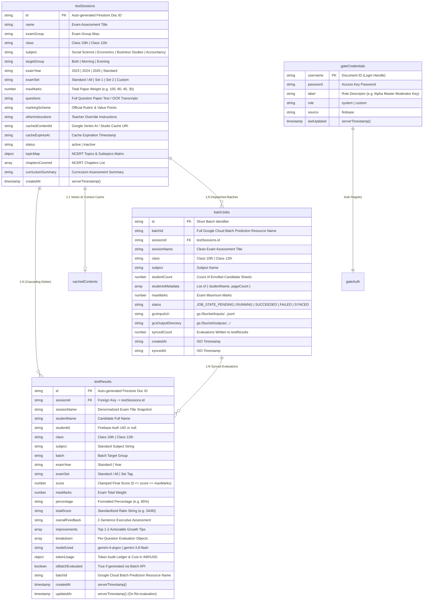

# Firestore Database & Data Architecture Specification
**Document Reference:** `docs/system/05-firestore-data-models.md`  
**System Scope:** NerdTutors Database Persistence, Schema Specifications & Data Integrity Invariants  
**Firebase SDK:** Firebase JS SDK v9.22.0 (Modular API: `initializeApp`, `getFirestore`, `getAuth`)  
**Firebase Project ID:** `nerd-tutors-001` (`nerd-tutors-001.firebaseapp.com`)

---

## 1. Architectural Overview & Entity Relationship

NerdTutors utilizes Google Cloud Firebase Firestore as its primary document-oriented NoSQL persistence engine. The schema decouples administrative exam authoring, automated OCR/multimodal AI grading, gate credential governance, and asynchronous batch evaluations.



---

## 2. Comprehensive Firestore Collection Schemas

### 2.1 Collection: `testSessions`
- **Location:** `testSessions/{sessionId}`
- **Originating Code:** `js/admin-modules/session-manager.js` (`createTestSession`, `editSession`, `populateMockData`), `ocr-scan.html`, `js/matrix-manager.js`.
- **Purpose:** Central repository for exam papers, marking schemes, moderator directives, curriculum topic mappings, and Google Vertex AI Context Cache keys.

#### Document Schema & Field Definitions:

| Field | Type | Required | Description & Constraints |
|---|---|---|---|
| `id` | `string` | Yes | Firestore auto-generated document identifier. |
| `name` | `string` | Yes | Exam session title (e.g., `"Economics Unit Test 1"`, `"Accountancy Pre-Board Exam"`). |
| `examGroup` | `string` | Yes | Exam grouping alias; defaults to `name`. |
| `class` | `string` | Yes | Academic grade: strictly `'Class 10th'` or `'Class 12th'`. |
| `subject` | `string` | Yes | Aligned subject: `'Social Science'` for 10th; `'Economics'`, `'Business Studies'`, or `'Accountancy'` for 12th. |
| `targetGroup` | `string` | No | Batch filter: `'Both'`, `'Morning'`, or `'Evening'` (defaults to `'Both'`). |
| `examYear` | `string` | No | Exam academic year: `'2023'`, `'2024'`, `'2026'`, or `'Standard'`. |
| `examSet` | `string` | No | Question set variant: `'Standard / All'`, `'Set 1'`, `'Set 2'`, or custom name. |
| `maxMarks` | `number` | Yes | Total maximum paper marks (e.g. `100`, `80`, `40`, `30`). Invariant: `maxMarks > 0`. |
| `questions` | `string` | Yes | Plain-text / markdown / OCR-extracted question paper contents. |
| `markingScheme` | `string` | Yes | Official CBSE rubric, value points, model answers, and step marks. |
| `otherInstructions` | `string` | No | Teacher override rules (e.g. strictness directives, leniency allowances). |
| `cachedContentId` | `string` | No | Google Vertex AI or Google AI Studio context cache resource name (e.g., `cachedContents/123456789012`). Enables 75% token discount. |
| `cacheExpiresAt` | `string` | No | Expiration timestamp of the active Google Context Cache. |
| `status` | `string` | Yes | Session availability: `'active'` or `'inactive'`. Default: `'active'`. |
| `topicMap` | `object` | No | NCERT curriculum analysis mapping question IDs to chapters, topics, subtopics, and Bloom's Taxonomy cognitive domains. Generated by `/api/analyze-topics.js`. |
| `chaptersCovered` | `array<string>` | No | Distinct NCERT syllabus chapters covered in this paper. |
| `curriculumSummary` | `string` | No | 2-3 sentence AI overview of syllabus and weight distribution. |
| `createdAt` | `FieldValue` | Yes | `serverTimestamp()`. Creation timestamp. |

#### Invariants:
1. **Class-Subject Invariant:** A session can NEVER combine `Class 10th` with Commerce subjects (`Economics`, `Accountancy`, `Business Studies`), or `Class 12th` with `Social Science`. Enforced via `syncClassSubjects()`.
2. **Positive Weight Invariant:** `maxMarks` must be a positive integer > 0.
3. **Status Toggle:** Soft-deactivation via `status: 'inactive'` stops student submissions in `ocr-scan.html` while preserving historic student records.

---

### 2.2 Collection: `testResults`
- **Location:** `testResults/{resultId}`
- **Originating Code:** `ocr-scan.html` (`submitWithRetry`, `updateDoc`), `js/admin-modules/bundle-evaluator.js` (`checkAndSyncBatch`), `js/admin-modules/session-manager.js` (`populateMockData`, `editStudentScore`, `editQuestionScore`).
- **Purpose:** Stores evaluated student report cards, overall scores, question-by-question marks breakdowns, diagnostic feedback, and token audit receipts.

#### Document Schema & Field Definitions:

| Field | Type | Required | Description & Constraints |
|---|---|---|---|
| `id` | `string` | Yes | Firestore auto-generated document identifier. |
| `sessionId` | `string` \| `null` | Yes | Foreign key to `testSessions.id`. If test is deleted, becomes orphaned. |
| `sessionName` | `string` | Yes | Denormalized snapshot of the exam title at time of grading. |
| `studentName` | `string` | Yes | Candidate full name (e.g., `"Amit Pathak"`, `"Priya Sharma"`). |
| `studentId` | `string` \| `null` | No | Authenticated Firebase UID if logged in; `null` for anonymous/direct OCR. |
| `class` | `string` | Yes | Academic grade: `'Class 10th'` or `'Class 12th'`. |
| `subject` | `string` | Yes | Exam subject. |
| `batch` / `targetGroup` | `string` | No | Batch enrollment (`'Both'`, `'Morning'`, `'Evening'`). |
| `examYear` | `string` | No | Snapshot of session exam year. |
| `examSet` | `string` | No | Snapshot of question paper set. |
| `score` | `number` | Yes | Final awarded score. **Hard-clamped:** `0 <= score <= maxMarks`. |
| `maxMarks` | `number` | Yes | Session maximum marks (locked to paper weight). |
| `percentage` | `string` | No | Computed percentage string e.g. `"85%"`. |
| `totalScore` | `string` | No | Formatted score ratio string e.g. `"34/40"`. |
| `overallFeedback` | `string` | Yes | 2-sentence executive performance summary in clean plain text. |
| `improvements` | `array<string>` | Yes | 1-2 high-impact actionable improvement tips (max 15 words each). |
| `breakdown` / `results` | `array<object>` | Yes | Array of leaf-level question performance items (schema below). |
| `modelUsed` | `string` | Yes | Model identifier: `'gemini-4-argon'` (primary) or `'gemini-3.8-flash'`. |
| `tokenUsage` | `object` \| `null` | No | Audit ledger: `promptTokens`, `cachedTokens`, `completionTokens`, `totalTokens`, `costInr`, `costUsd`. |
| `isBatchEvaluated` | `boolean` | No | `true` if generated via asynchronous Vertex AI Batch Prediction. |
| `batchId` | `string` | No | Google Cloud Batch resource identifier if evaluated via batch. |
| `createdAt` | `FieldValue` | Yes | `serverTimestamp()`. Timestamp of initial evaluation. |
| `updatedAt` | `FieldValue` | No | `serverTimestamp()`. Written strictly during in-place re-evaluations. |

#### Question Breakdown Object Sub-Schema (`breakdown[]` / `results[]`):
```json
{
  "questionNumber": "Q1",
  "questionId": "Q1",
  "questionText": "",
  "score": 1.0,
  "maxMarks": 1.0,
  "feedback": "Option (B) is correct.",
  "studentAnswerText": "Option B",
  "modelAnswer": "B",
  "improvements": [],
  "incorrectPhrases": []
}
```

#### Derived Badge Classification States (Used across `results.html`, `ocr-scan.html`, and `admin.js`):
- **Correct (`✓`):** `score === maxMarks` (Green pill, `#f0fdf4`, border `#bbf7d0`).
- **Partial (`!`):** `score > 0 && score < maxMarks` (Amber pill, `#fffaf0`, border `#fef3c7`).
- **Incorrect (`✗`):** `score === 0` (Red pill, `#fff5f5`, border `#fed7d7`).
- **Unattempted:** Question omitted in answer sheet (`score = 0`, feedback indicates skipped question; Gray pill `#f1f5f9`).

#### Strict Mathematical & Grading Invariants:
1. **Mathematical Sum Invariant:** Programmatic recalculation enforces:
   $$\text{totalScore} = \sum_{i=1}^{n} \text{results}[i].\text{score}$$
   Under no condition can the overall total diverge from the sum of leaf items.
2. **Boundary Clamping Invariant:** Every question score is bounded:
   $$0 \le \text{results}[i].\text{score} \le \text{results}[i].\text{maxMarks}$$
   $$\text{totalScore} = \min(\max(0, \text{totalScore}), \text{maxMarks})$$
3. **Dynamic Binary MCQ Hard-Lock:** For questions where `maxMarks <= 1.0` and identifier represents an MCQ, the score is strictly binary: `score = maxMarks` if correct; `score = 0.0` if wrong. Fractional marks (0.25, 0.5) are programmatically rejected.
4. **Defend / Refute Stance Governance:** An incorrect stance on Defend/Refute questions caps the awarded marks to a maximum of `1.0`.

---

### 2.3 Collection: `gateCredentials`
- **Location:** `gateCredentials/{username}`
- **Originating Code:** `js/admin-modules/gate-manager.js` (`shiftCredentialsToFirebase`, `loadGateCredentials`), `api/manage-gate.js`, `api/verify-gate.js`.
- **Purpose:** Stores moderator access keys and authentication tokens in Firestore to enable dynamic, cloud-synchronized credential governance without code deployments.

#### Document Schema & Field Definitions:

| Field | Type | Required | Description |
|---|---|---|---|
| `username` | `string` | Yes | Document Key & unique login handle (e.g., `nerd_tutor_alpha`, `moderator_mumbai`). |
| `password` | `string` | Yes | Plaintext access password. Invariant: length >= 4. |
| `label` | `string` | No | Human-readable key descriptor (e.g. `"Alpha Master Moderator Key"`). |
| `role` | `string` | Yes | Key authority: `'system'` (built-in default) or `'custom'` (admin-created). |
| `source` | `string` | Yes | Fixed value: `'firebase'`. |
| `createdAt` | `string` | No | Creation ISO date string. |
| `lastUpdated` | `FieldValue` | Yes | `serverTimestamp()`. Last synchronization timestamp. |

#### Two-Way Synchronization Architecture:
1. **Built-in Defaults:** 5 system credentials (`nerd_tutor_alpha` to `nerd_tutor_epsilon`) are pre-seeded in code.
2. **Shift to Firebase:** Admin portal action `🔥 Shift / Sync All to Firebase` executes `setDoc(doc(db, 'gateCredentials', cred.username), { ... }, { merge: true })` for every active credential.
3. **Resilient Dual-Storage:** 
   - `gate-manager.js` attempts to read from Firestore collection `gateCredentials`.
   - If Firestore permissions block direct browser reads, it falls back to serverless `/api/manage-gate` (`gate-credentials.json` on Vercel).
   - Once loaded from Firestore, keys are non-blockingly synced back to `/api/manage-gate` via `action: 'sync'`.
4. **Current Gate Status:** Secondary gate restrictions have been disabled across endpoints per directive; credentials registry remains active in Firestore for administrative moderation tracking.

---

### 2.4 Entity: `batchJobs`
- **Location:** Multi-Tier Architecture:
  1. Google Cloud Storage Manifest: `gs://${bucket}/manifests/${shortBatchId}.json`
  2. Serverless File Registry: `api/batch-jobs.json` (fallback `/tmp/batch-jobs.json`)
  3. Client Browser Cache: `localStorage.getItem('nt_batch_job_' + cleanDocId)`
  4. Synced Target: Firestore collection `testResults` (`where('batchId', '==', batchId)`)
- **Originating Code:** `api/batch-evaluate.js`, `js/admin-modules/bundle-evaluator.js`.
- **Purpose:** Tracks asynchronous Google Cloud Vertex AI Batch Prediction Jobs (50% cost discount) for bulk answer sheet bundles.

#### Schema Fields:

| Field | Type | Description |
|---|---|---|
| `id` | `string` | Short numeric job ID extracted from Google Cloud resource name. |
| `batchId` | `string` | Full Vertex AI resource name: `projects/.../locations/.../batchPredictionJobs/...` or `batches/...`. |
| `sessionId` | `string` \| `null` | Linked `testSessions.id` for session association. |
| `sessionName` | `string` | Human-readable assessment title. |
| `class` | `string` | Grade level (`'Class 12th'` or `'Class 10th'`). |
| `subject` | `string` | Exam subject. |
| `studentCount` | `number` | Number of candidate papers in the batch payload. |
| `studentsMetadata` | `array<object>` | Metadata array: `[{ studentName: "Priya", pageCount: 3 }]`. |
| `maxMarks` | `number` | Paper maximum marks (default 30 or 40). |
| `status` | `string` | Lifecycle state: `JOB_STATE_PENDING`, `JOB_STATE_RUNNING`, `JOB_STATE_SUCCEEDED`, `JOB_STATE_FAILED`, `JOB_STATE_CANCELLED`, or `SYNCED`. |
| `gcsInputUri` | `string` | GCS URI for JSONL request payload (`gs://${bucket}/inputs/...jsonl`). |
| `gcsOutputDirectory` | `string` | GCS URI prefix for completed predictions (`gs://${bucket}/outputs/.../`). |
| `createdAt` | `string` | ISO creation timestamp. |
| `syncedCount` | `number` | Number of student records parsed and saved into Firestore `testResults`. |
| `syncedAt` | `string` | ISO timestamp of the sync execution. |

#### Batch-to-Firestore Ingestion Lifecycle:
1. **Dispatch:** `api/batch-evaluate.js` uploads student image JSONL to GCS and launches a Vertex AI Batch Prediction Job.
2. **Poll Status:** Admin UI queries `/api/batch-evaluate?action=status&batchId=...`.
3. **Execution Completion:** When Google Cloud reports `JOB_STATE_SUCCEEDED`, the teacher clicks `🔄 Check Status & Sync`.
4. **Idempotent Ingestion:** 
   - Queries `collection(db, 'testResults')` where `batchId == batchId`.
   - Iterates through parsed student results: if candidate is already present in `testResults`, insertion is skipped.
   - For new candidates, an atomic `addDoc(collection(db, 'testResults'), payload)` writes the full report card with `isBatchEvaluated: true`.
   - Local manifest is flagged as `status: 'SYNCED'`.

---

## 3. Data Flow & System Invariants

### 3.1 Cascading Delete Invariant
**Problem:** In a NoSQL document database like Firestore, deleting a parent document (`testSessions`) leaves child evaluations (`testResults`) orphaned, corrupting student analytics and matrix views.  
**Implementation:** `js/admin-modules/session-manager.js` -> `deleteSession(id)`:
1. Scans `testResults` for all documents matching either:
   - `data.sessionId === id`
   - `data.sessionName === sessionData.name && !data.sessionId` (legacy migration fallback)
2. Alerts the administrator with the exact count of student records scheduled for deletion.
3. Executes a parallel batch delete:
   ```javascript
   await Promise.all(matchingResults.map(r => deleteDoc(doc(db, 'testResults', r.id))));
   ```
4. Only after all student records are purged, deletes the parent session document:
   ```javascript
   await deleteDoc(doc(db, 'testSessions', id));
   ```
5. **Guarantee:** No dangling or orphaned child records are created when a test session is deleted through the portal.

---

### 3.2 In-Place Re-Evaluation `updateDoc` Invariant
**Problem:** When a moderator re-submits a student paper to correct OCR misreads or adjust prompts, standard `addDoc` operations generate duplicate test result entries for that student.  
**Implementation:** `ocr-scan.html` (Lines 1490–1498 and 1920–1945):
1. Upon initial submission, `addDoc` stores the new document ID in memory (`currentSavedResultId = docRef.id`) and caches the payload string (`lastPayloadString = payloadString`).
2. Syncs `resultId` into the URL query parameters without reloading the page:
   ```javascript
   const newUrl = new URL(window.location.href);
   newUrl.searchParams.set('resultId', docRef.id);
   window.history.replaceState({ resultId: docRef.id }, '', newUrl.toString());
   ```
3. When the teacher clicks `🔄 Re-evaluate`, the client invokes `api/ocr-evaluate` with the cached image payload.
4. Instead of creating a new document, it executes an in-place mutation:
   ```javascript
   await updateDoc(doc(db, 'testResults', currentSavedResultId), {
       score: clampedScore,
       maxMarks: lockedMax,
       overallFeedback: report.overallFeedback,
       improvements: report.improvements,
       breakdown: report.results || [],
       modelUsed: report.modelUsed || 'gemini-4-argon',
       tokenUsage: report.tokenUsage || null,
       updatedAt: serverTimestamp()
   });
   ```
5. **Guarantee:** Document ID stability is preserved. Bookmarked links, student progress charts, and matrix records update in-place with zero duplicate entries.

---

### 3.3 Orphaned Data Criteria & Bulk Remediation
**Definition:** A document in `testResults` is classified as **Orphaned** if:
1. `data.sessionId` is missing, `null`, or empty string; OR
2. `data.sessionId` does NOT exist in the set of active `testSessions` IDs (`!validSessionIds.has(data.sessionId)`).

**Detection & UI Flow:** `js/admin-modules/session-manager.js` -> `loadTestSessionsForDropdown()`:
- Scans `testResults` against the active set of `testSessions`.
- If `orphanedResultsList.length > 0`:
  - Renders a danger button in the header: `⚠️ Clean Orphaned Records (N)`.
  - Appends an option to the session selector: `⚠️ Orphaned Evaluations (N from deleted tests)` (`value="__ORPHANED__"`).
- Selecting `__ORPHANED__` renders the orphaned records table with an option to inspect or purge individual rows.
- Clicking `Clean Orphaned Records` triggers `cleanOrphanedResults()`:
  ```javascript
  await Promise.all(orphans.map(o => deleteDoc(doc(db, 'testResults', o.id))));
  ```
- **Guarantee:** Administrators have complete visibility and one-click bulk cleanup capability for any orphaned data introduced by legacy scripts or manual Firestore console deletions.

---

### 3.4 Dynamic Class-Subject Alignment Invariant
**Standard:** CBSE exam boards mandate strict segregation between Secondary (Class 10th) and Senior Secondary Commerce (Class 12th) curricula.
- **Rule Matrix:**
  - `Class 10th` $\rightarrow$ `['Social Science']` (CBSE Code 087)
  - `Class 12th` $\rightarrow$ `['Economics', 'Business Studies', 'Accountancy']` (CBSE Codes 030, 054, 055)

**Implementation:** Synchronized via `syncClassSubjects(classEl, subjectEl, targetSubject)` in `js/admin-modules/admin-utils.js` and `ocr-scan.html`:
```javascript
export function syncClassSubjects(classElement, subjectElement, targetSubject = null) {
    if (!classElement || !subjectElement) return;
    const cls = classElement.value;
    const subjects = cls === 'Class 10th'
        ? ['Social Science']
        : ['Economics', 'Business Studies', 'Accountancy'];

    const current = targetSubject || subjectElement.value;
    subjectElement.innerHTML = subjects.map(s => `<option value="${s}">${s}</option>`).join('');
    subjectElement.value = subjects.includes(current) ? current : subjects[0];
}
```
**Enforcement Points:**
1. **Admin Portal:** Attached to `sessionClass.addEventListener('change')` and `editSessionClass.addEventListener('change')`.
2. **OCR Portal:** Attached to `studentClass.addEventListener('change')`.
3. **Dashboard Analytics:** Filters automatically update available subject tabs when switching between Class 10th and Class 12th.
4. **Guarantee:** Invalid permutations (e.g. `Class 10th Accountancy`) can never be authored into `testSessions` or submitted into `testResults`.

---

## 4. Cross-Module Collection Access Matrix

| Module / Component | Collection | Read | Create | Update | Delete | Primary Operation / Method |
|---|---|:---:|:---:|:---:|:---:|---|
| `admin.js` / `session-manager.js` | `testSessions` | ✅ | ✅ | ✅ | ✅ | `createTestSession`, `editSession`, `deleteSession`, `toggleSessionStatus` |
| `admin.js` / `session-manager.js` | `testResults` | ✅ | ✅ (Mock) | ✅ | ✅ | `loadResultsForSession`, `deleteResult`, `editStudentScore`, `editQuestionScore`, `cleanOrphanedResults` |
| `bundle-evaluator.js` | `testSessions` | ✅ | ❌ | ❌ | ❌ | `loadBundleSessions`, session cache status inspection |
| `bundle-evaluator.js` | `testResults` | ✅ | ✅ | ❌ | ❌ | `checkAndSyncBatch` (Idempotent batch evaluation ingestion) |
| `gate-manager.js` | `gateCredentials` | ✅ | ✅ | ✅ | ✅ | `loadGateCredentials`, `shiftCredentialsToFirebase`, `setDoc` |
| `ocr-scan.html` | `testSessions` | ✅ | ❌ | ✅ | ❌ | Fetch active sessions, update `cachedContentId` |
| `ocr-scan.html` | `testResults` | ✅ | ✅ | ✅ | ❌ | Initial grading `addDoc`, in-place re-evaluation `updateDoc` |
| `results.html` | `testResults` | ✅ | ❌ | ❌ | ❌ | Student report card display, token usage inspection |
| `results.html` | `testSessions` | ✅ | ❌ | ❌ | ❌ | Question text and model answer resolution |
| `dashboard.js` | `testResults` | ✅ | ❌ | ❌ | ❌ | Real-time `onSnapshot`, class analytics, grade distributions |
| `dashboard.js` | `testSessions` | ✅ | ❌ | ❌ | ❌ | Filter synchronization and dropdown population |
| `matrix-manager.js` | `testResults` | ✅ | ❌ | ❌ | ❌ | Natural question sorting, item-response student grid |
| `matrix-manager.js` | `testSessions` | ✅ | ❌ | ✅ | ❌ | NCERT `topicMap` and `chaptersCovered` persistence |
| `student-progress-chart.js` | `testResults` | ✅ | ❌ | ❌ | ❌ | Longitudinal multi-exam trendlines across subjects |

---

## 5. Security & Persistence Best Practices

1. **Client-Side Firebase Auth Gates:** Access to administrative mutations on `testSessions` and `gateCredentials` is protected by Google Auth / Email Password checks against `ADMIN_EMAILS` (`firebase-config.js`).
2. **Serverless Secret Decoupling:** Google Cloud Vertex AI private keys and service accounts never touch frontend code; all AI evaluation calls pass through serverless endpoints (`/api/*`).
3. **Optimistic Offline Recovery:** `ocr-scan.html` preserves in-memory payloads, student details, and image blobs in `localStorage` / `sessionStorage` so network interruptions never cause data loss.
4. **Deterministic Evaluation:** All AI evaluation calls are seed-pinned (`seed: 42`, `temperature: 0.0`), guaranteeing reproducible results when re-evaluating identical documents into `testResults`.
