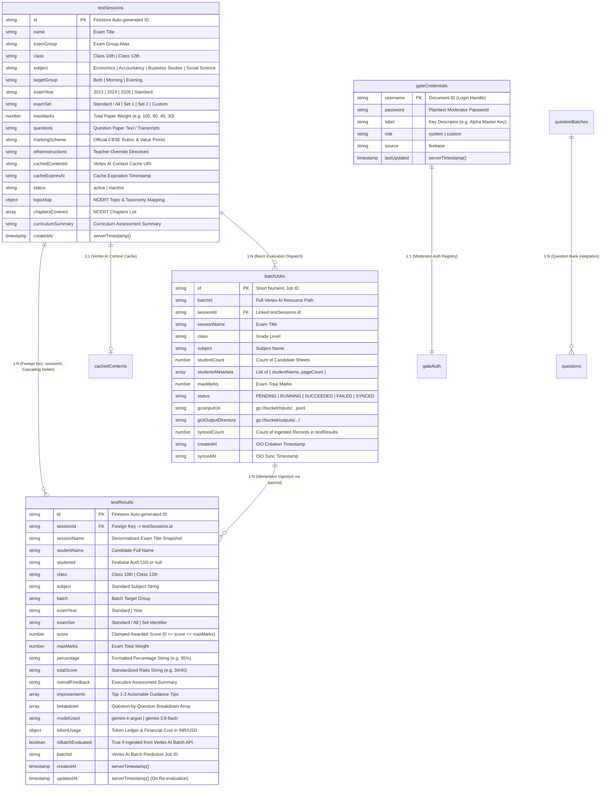

# Firestore Database Architecture, Collection Catalog & Data Schemas

**Document Reference:** `docs/system/data-schemas.md`  
**System Scope:** NerdTutors Persistence Layer, Schema Specifications, Referential Integrity, Access Patterns & Security Governance  
**Firebase SDK Version:** Google Cloud Firebase JS Modular SDK v9.22.0  
**Firebase Project ID:** `nerd-tutors-001` (`nerd-tutors-001.firebaseapp.com`)  
**Storage Bucket:** `nerd-tutors-001.firebasestorage.app`  

---

## 1. Firestore Architecture Overview

NerdTutors utilizes Google Cloud Firebase Firestore as its central document-oriented NoSQL persistence engine. The data architecture is designed to support high-throughput multimodal AI grading of handwritten CBSE answer sheets, longitudinal student progress analytics, item-response question performance matrices, and administrative session management.



### 1.1 Client SDK vs. Serverless Execution Model

The system employs a hybrid execution topology dividing responsibility between client-side browser contexts and stateless serverless endpoints:

1. **Client-Side Firebase SDK (`firebase-config.js`)**:
   - Imports modular Firebase v9.22.0 libraries via Google CDN (`https://www.gstatic.com/firebasejs/9.22.0/`).
   - Exports the initialized Firestore database instance `db = getFirestore(app)`, Firebase Authentication `auth = getAuth(app)`, and `googleProvider = new GoogleAuthProvider()`.
   - Admin authorization on the client is checked against the static allowlist `ADMIN_EMAILS` (`kaushtubh457@gmail.com`, `jatinthacker000@gmail.com`, `pathak.amitkumar@hrjohnsonindia.com`).
   - Browser code directly binds reactive queries, document subscriptions (`onSnapshot`), and writes for `testSessions`, `testResults`, and `gateCredentials`.

2. **Serverless Backend Endpoints (`/api/*`)**:
   - Node.js runtime deployed on Vercel Serverless Functions.
   - Responsible for compute-heavy, security-sensitive operations: Google Cloud Vertex AI access token negotiation (`vertex-auth.js`), high-reasoning multimodal grading (`api/ocr-evaluate.js`), large-scale batch evaluation scheduling (`api/batch-evaluate.js`), Google Context Cache compilation (`api/create-cache.js`), PDF text parsing (`api/extract-pdf.js`), and NCERT curriculum analytics (`api/analyze-topics.js`).
   - Private credentials (GCP Service Account keys, HMAC signing secrets, Gemini API keys) are kept strictly on the backend and are never exposed to the client bundle.

### 1.2 Direct Writes vs. Backend Writes & The Client Firebase Rules Constraint

A fundamental architectural constraint governs where data is written:

* **The Client Firebase Rules Constraint (Architectural Trap 3)**:
  The Firebase project belongs to the institutional client, not the software development team. The developers do **not** possess administrative console privileges to deploy updated Firestore Security Rules.
  The client's active Firestore Security Rules explicitly permit access **only** to the following collections:
  - `testResults` (Full read/write for authenticated users)
  - `testSessions` (Read for authenticated users, write for admin)
  - `questions` (Read for authenticated users, write for admin)
  - `questionBatches` (Read for authenticated users, write for admin)
  - `gateCredentials` (Admin authentication / custom permissions)

* **The Failure Mode**:
  Attempting to create or query any newly invented collection from client JavaScript (e.g., `collection(db, 'batchJobs')`, `collection(db, 'evalQueue')`, `collection(db, 'auditLogs')`) triggers an immediate unhandled fatal error:
  ```text
  FirebaseError: Missing or insufficient permissions.
  ```

* **Storage Partitioning Strategy**:
  1. **Direct Client Writes**: The frontend directly executes `addDoc()`, `updateDoc()`, `setDoc()`, and `deleteDoc()` exclusively on the permitted collections (`testSessions`, `testResults`, `gateCredentials`, `questions`, `questionBatches`).
  2. **Batch Job Metadata Storage**: Because the client cannot create a Firestore `batchJobs` collection, batch job tracking utilizes a distributed multi-tier fallback:
     - Google Cloud Storage Manifests: `gs://${GCP_STORAGE_BUCKET}/manifests/${shortBatchId}.json`
     - Serverless Local Storage: `api/batch-jobs.json` (with fallback to `/tmp/batch-jobs.json` in serverless ephemeral storage)
     - Client Browser Storage: `localStorage.getItem('nt_batch_job_' + cleanDocId)`
  3. **Evaluation Result Destination**: All student report cards—whether evaluated in real-time via single-pass vision or asynchronously via Vertex AI Batch Prediction—are persisted **exclusively into `collection(db, 'testResults')`**.

---

## 2. Collection Catalog & Exhaustive Data Schemas

### 2.1 Collection: `testSessions`

* **Firestore Path:** `testSessions/{sessionId}`
* **Primary Source Files:** `js/admin-modules/session-manager.js`, `ocr-scan.html`, `js/matrix-manager.js`, `dashboard.js`
* **Purpose:** Serves as the central definition of an exam test paper. Contains questions, CBSE marking schemes, teacher overrides, NCERT curriculum maps, and Google Cloud Context Cache identifiers.

#### Document Schema:

| Field Name | Data Type | Required | Default Value | Description & Constraints |
|---|---|:---:|---|---|
| `id` | `string` | Yes | Auto-generated | Firestore auto-generated document identifier (e.g. `"session_abc123"`). |
| `name` | `string` | Yes | `""` | Primary title of the examination (e.g., `"Macroeconomics Unit Test 1"`, `"Pre-Board Exam 2026"`). |
| `examGroup` | `string` | Yes | `name` | Logical grouping alias; set equal to `name` during creation. |
| `class` | `string` | Yes | `"Class 12th"` | Target academic grade. Strictly constrained to `"Class 10th"` or `"Class 12th"`. |
| `subject` | `string` | Yes | `"Economics"` | Academic subject. Must conform to Class-Subject alignment rules. |
| `targetGroup` | `string` | No | `"Both"` | Student batch audience: `"Both"`, `"Morning"`, or `"Evening"`. |
| `examYear` | `string` | No | `"2023"` | Academic examination year (e.g., `"2023"`, `"2024"`, `"2026"`, `"Standard"`). |
| `examSet` | `string` | No | `"Standard / All"` | Examination paper set variant: `"Standard / All"`, `"Set 1"`, `"Set 2"`, or custom text. |
| `maxMarks` | `number` | Yes | `100` | Paper total maximum marks (`parseInt(sessionMaxMarks) \|\| 100`). Invariant: `maxMarks > 0`. |
| `questions` | `string` | Yes | `""` | Full plain-text, markdown, or OCR-extracted question paper text. |
| `markingScheme` | `string` | Yes | `""` | Official CBSE marking scheme, value points, step-marking rubrics, and model answers. |
| `otherInstructions` | `string` | No | `""` | Teacher override directives (e.g., strictness modifiers, allowance of regional terms). |
| `cachedContentId` | `string` \| `null` | No | `null` | Google Cloud Vertex AI Context Cache resource URI (e.g., `"cachedContents/492019482012"`). Enables 75% token discount. Invalided to `null` on paper edit. |
| `cacheExpiresAt` | `string` \| `null` | No | `null` | ISO 8601 expiration timestamp of the active Google Context Cache (typically 72 hours). |
| `status` | `string` | Yes | `"active"` | Test availability status: `"active"` or `"inactive"`. Inactive sessions are hidden from student OCR submission dropdowns. |
| `topicMap` | `object` \| `null` | No | `null` | Key-value mapping of Question Numbers (`"Q1"`, `"Q2"`) to NCERT curriculum topics, subtopics, and Bloom's cognitive taxonomy levels. Generated by `/api/analyze-topics.js`. |
| `chaptersCovered` | `array<string>` | No | `[]` | Distinct NCERT syllabus chapter titles covered in the examination paper. |
| `curriculumSummary`| `string` | No | `""` | 2-3 sentence AI executive summary of syllabus coverage and weight distribution. |
| `createdAt` | `FieldValue` | Yes | `serverTimestamp()` | Server-side creation timestamp. |

#### Sub-Schema: `topicMap` Object
```json
{
  "Q1": {
    "topic": "Money and Banking",
    "subtopic": "Functions of Central Bank - Lender of Last Resort",
    "chapter": "Money and Banking",
    "cognitiveDomain": "Remembering & Understanding",
    "marks": 1
  },
  "Q7": {
    "topic": "Government Budget and the Economy",
    "subtopic": "Fiscal Deficit Implications",
    "chapter": "Government Budget",
    "cognitiveDomain": "Analyzing & Evaluating",
    "marks": 4
  }
}
```

---

### 2.2 Collection: `testResults`

* **Firestore Path:** `testResults/{resultId}`
* **Primary Source Files:** `ocr-scan.html`, `results.html`, `dashboard.js`, `js/matrix-manager.js`, `js/admin-modules/bundle-evaluator.js`, `js/admin-modules/session-manager.js`, `mcq-test.js`
* **Purpose:** Stores student evaluation report cards, final awarded scores, question-by-question scoring breakdowns, actionable student feedback, and token consumption ledgers.

#### Document Schema:

| Field Name | Data Type | Required | Default Value | Description & Constraints |
|---|---|:---:|---|---|
| `id` | `string` | Yes | Auto-generated | Firestore auto-generated document identifier. |
| `sessionId` | `string` \| `null` | Yes | `null` | Foreign key referencing `testSessions.id`. **Must not be null** for batch evaluations to prevent orphaning. |
| `sessionName` | `string` | Yes | `""` | Denormalized snapshot of the exam session title at time of grading. |
| `studentName` | `string` | Yes | `"Student"` | Full candidate name (e.g. `"Priya Sharma"`, `"Amit Pathak"`). Resolved from model output or manifest. |
| `studentId` | `string` \| `null` | No | `null` | Firebase Auth UID (`auth.currentUser.uid`) if authenticated; `null` for anonymous or batch submissions. |
| `class` | `string` | Yes | `"Class 12th"` | Academic grade: strictly `"Class 10th"` or `"Class 12th"`. |
| `subject` | `string` | Yes | `"Economics"` | Aligned academic subject string. |
| `batch` / `targetGroup` | `string` | No | `"Both"` | Student batch tag (`"Both"`, `"Morning"`, `"Evening"`). |
| `examYear` | `string` | No | `"Standard"` | Snapshot of exam academic year. |
| `examSet` | `string` | No | `"Standard / All"` | Question paper set variant. |
| `score` | `number` | Yes | `0` | Final awarded score. **Hard-clamped:** strictly `0 <= score <= maxMarks`. |
| `maxMarks` | `number` | Yes | `40` | Total maximum paper marks. Locked to session paper weight. |
| `percentage` | `string` | No | `""` | Formatted percentage string (e.g. `"85%"`). Derived via `Math.round((score / maxMarks) * 100) + '%'`. |
| `totalScore` | `string` | No | `""` | Standardized ratio string (e.g. `"34/40"`). Standardizes OCR and MCQ test formats. |
| `overallFeedback` | `string` | Yes | `""` | Concise 2-sentence executive summary of student performance without preamble. |
| `improvements` | `array<string>` | Yes | `[]` | 1-2 actionable, growth-oriented student recommendations (strictly capped at 15 words each). |
| `breakdown` / `results` | `array<object>` | Yes | `[]` | Array of leaf-level question evaluation objects (see Breakdown Sub-Schema). |
| `modelUsed` | `string` | Yes | `"gemini-4-argon"` | Evaluation AI model identifier (`"gemini-4-argon"` primary, `"gemini-3.8-flash"` failover). |
| `tokenUsage` | `object` \| `null` | No | `null` | Comprehensive token audit receipt and cost accounting (see Token Sub-Schema). |
| `isBatchEvaluated` | `boolean` | No | `false` | Set to `true` if generated via asynchronous Vertex AI Batch Prediction API. |
| `batchId` | `string` \| `null` | No | `null` | Google Cloud Batch Prediction Job resource identifier for idempotent sync checking. |
| `testType` | `string` | No | `"ocr"` | Evaluation type discriminator: `"ocr"` (handwritten vision paper) or `"mcq"` (interactive online test). |
| `createdAt` | `FieldValue` | Yes | `serverTimestamp()` | Server timestamp of document insertion. |
| `updatedAt` | `FieldValue` | No | `undefined` | Server timestamp written strictly on in-place re-evaluation. |
| `submittedAt` | `FieldValue` | No | `undefined` | Legacy / MCQ submission timestamp (fallback for `createdAt`). |

#### Question Breakdown Object Sub-Schema (`breakdown[]` / `results[]`):
```json
{
  "questionNumber": "Q1",
  "questionId": "Q1",
  "questionText": "State the primary function of the Reserve Bank of India as a lender of last resort.",
  "score": 1.0,
  "maxMarks": 1.0,
  "feedback": "Correctly states that RBI provides liquidity to commercial banks during crisis.",
  "studentAnswerText": "RBI acts as lender of last resort by lending to scheduled banks in emergencies.",
  "modelAnswer": "It provides emergency advances to solvent commercial banks facing temporary liquidity crisis.",
  "isRelevant": true,
  "improvements": [
    "Mention that collateral is required for financial advances."
  ],
  "incorrectPhrases": [
    {
      "wrongText": "unconditional free grant",
      "explanation": "RBI loans are advances subject to interest, not free financial grants."
    }
  ]
}
```

#### Token Consumption Sub-Schema (`tokenUsage`):
```json
{
  "promptTokens": 8420,
  "cachedTokens": 7150,
  "nonCachedPromptTokens": 1270,
  "completionTokens": 950,
  "totalTokens": 9370,
  "costInr": 2.85,
  "costUsd": 0.0342,
  "thinkingLevel": "low",
  "pricingTier": "Gemini 4 Argon Direct Vision (Official GCP List Price)",
  "apiCallsCount": 1
}
```

#### Derived Badge Classification States:
Frontend components (`results.html`, `ocr-scan.html`, `dashboard.js`, `admin.js`) map question results into three badge states:
1. **Correct (`✓`)**: `score === maxMarks` (Rendered with green styling: background `#f0fdf4`, border `#bbf7d0`, text `#15803d`).
2. **Partial (`!`)**: `score > 0 && score < maxMarks` (Rendered with amber styling: background `#fffaf0`, border `#fef3c7`, text `#b7791f`).
3. **Incorrect (`✗`)**: `score === 0` (Rendered with red styling: background `#fff5f5`, border `#fed7d7`, text `#c53030`).
4. **Unattempted**: Identified when student text is missing or marked omitted (`score = 0`, feedback indicates non-attempt; rendered in neutral gray `#f1f5f9`).

---

### 2.3 Collection: `gateCredentials`

* **Firestore Path:** `gateCredentials/{username}`
* **Primary Source Files:** `js/admin-modules/gate-manager.js`, `api/manage-gate.js`, `api/verify-gate.js`
* **Purpose:** Stores moderator access keys and authentication tokens in Firestore to enable dynamic, cloud-synchronized credential governance without code deployments.

#### Document Schema:

| Field Name | Data Type | Required | Default Value | Description & Constraints |
|---|---|:---:|---|---|
| `username` | `string` | Yes | Document Key | Unique moderator login handle (e.g., `"nerd_tutor_alpha"`, `"moderator_north"`). Document ID convention: `doc(db, 'gateCredentials', username)`. |
| `password` | `string` | Yes | `""` | Plaintext access password. Invariant: `password.length >= 4`. |
| `label` | `string` | No | `"Moderator Gate Key"` | Human-readable descriptor (e.g., `"Alpha Master Moderator Key"`). |
| `role` | `string` | Yes | `"custom"` | Authority tier: `"system"` (built-in default key) or `"custom"` (administrator-created key). |
| `source` | `string` | Yes | `"firebase"` | Provenance marker indicating cloud database persistence. |
| `createdAt` | `string` \| `FieldValue` | No | ISO String | Creation timestamp string or server timestamp. |
| `lastUpdated` | `FieldValue` | Yes | `serverTimestamp()` | Server timestamp of last credential modification or sync. |

#### Two-Way Synchronization Architecture:
1. **Built-in System Defaults:** Five master system keys are seeded in code (`nerd_tutor_alpha` through `nerd_tutor_epsilon`).
2. **Cloud Shift (`shiftCredentialsToFirebase`):** Clicking `"🔥 Shift / Sync All to Firebase"` in `admin.html` triggers `setDoc(doc(db, 'gateCredentials', cred.username), payload, { merge: true })` for every active credential.
3. **Resilient Two-Way Failover:**
   - Client first attempts to query `collection(db, 'gateCredentials')`.
   - If blocked by client Firestore permission rules, it falls back to `/api/manage-gate` (reading `gate-credentials.json` on Vercel).
   - Once retrieved from Firestore, credentials are asynchronously synced back to the serverless backend via `action: 'sync'`.
4. **Current Status:** Gate access restrictions have been removed across all grading endpoints per user directive. The registry remains maintained in Firestore for admin portal access tracking.

---

### 2.4 Entity: `batchJobs`

* **Persistence Topology:** Multi-Tier Architecture
  1. Google Cloud Storage: `gs://${GCP_STORAGE_BUCKET}/manifests/${shortBatchId}.json`
  2. Serverless File Registry: `api/batch-jobs.json` (fallback `/tmp/batch-jobs.json`)
  3. Client Browser LocalStorage: `localStorage.getItem('nt_batch_job_' + cleanDocId)`
  4. Synced Target: Firestore collection `testResults` (`where('batchId', '==', batchId)`)
* **Primary Source Files:** `api/batch-evaluate.js`, `js/admin-modules/bundle-evaluator.js`
* **Purpose:** Coordinates asynchronous Google Cloud Vertex AI Batch Prediction Jobs (50% official API discount) for large multi-student exam bundles (up to hundreds of answer sheet pages).

#### Data Schema:

| Field Name | Data Type | Required | Description |
|---|---|:---:|---|
| `id` | `string` | Yes | Short numeric batch identifier extracted from Google Cloud resource name (e.g., `"38491029481920"`). |
| `batchId` | `string` | Yes | Full Vertex AI resource name: `projects/{project}/locations/{location}/batchPredictionJobs/{id}`. |
| `sessionId` | `string` \| `null` | Yes | Linked `testSessions.id`. Critical invariant: must be non-null to prevent orphaned evaluations. |
| `sessionName` | `string` | Yes | Exam session title snapshot. |
| `class` | `string` | Yes | Grade level (`"Class 12th"` or `"Class 10th"`). |
| `subject` | `string` | Yes | Aligned academic subject string. |
| `studentCount` | `number` | Yes | Total count of candidate student answer sheets enrolled in the batch. |
| `studentsMetadata` | `array<object>` | Yes | Array of student descriptor objects: `[{ studentName: "Priya", pageCount: 3 }, ...]`. |
| `maxMarks` | `number` | Yes | Exam total maximum marks. |
| `status` | `string` | Yes | Batch lifecycle state (see Lifecycle States below). |
| `gcsInputUri` | `string` | Yes | Cloud Storage URI of JSONL request payload (`gs://${bucket}/inputs/...jsonl`). |
| `gcsOutputDirectory` | `string` | Yes | Cloud Storage URI prefix for generated model predictions (`gs://${bucket}/outputs/.../`). |
| `syncedCount` | `number` | No | Count of student records parsed and committed into Firestore `testResults`. |
| `createdAt` | `string` | Yes | ISO 8601 creation timestamp. |
| `syncedAt` | `string` | No | ISO 8601 timestamp when batch was synchronized to Firestore. |
| `errorDetails` | `object` \| `null` | No | Detailed error diagnostics if batch fails in Google Cloud. |

#### State Lifecycle:
```
[SUBMITTED]
    │
    ▼
JOB_STATE_PENDING ──► Enqueued in Google Cloud distributed scheduler
    │
    ▼
JOB_STATE_RUNNING ──► Multi-node vision reasoning actively underway
    │
    ├─────────────────────────────┬─────────────────────────────┐
    ▼                             ▼                             ▼
JOB_STATE_SUCCEEDED        JOB_STATE_FAILED           JOB_STATE_CANCELLED
    │                      (Quota/Syntax error)       (Aborted by admin)
    ▼
[CHECK & SYNC]
    │
    ▼
  SYNCED ──► Idempotent batch insertion into Firestore `testResults`
```

---

### 2.5 Auxiliary Collections (`questions` & `questionBatches`)

#### Collection: `questions`
* **Firestore Path:** `questions/{questionId}`
* **Primary Source Files:** `js/admin-modules/question-manager.js`, `js/admin-modules/excel-uploader.js`, `mcq-test.js`
* **Purpose:** Item bank of individual multiple-choice and subjective practice questions.

| Field Name | Data Type | Required | Description |
|---|---|:---:|---|
| `id` | `string` | Yes | Firestore auto-generated document identifier. |
| `text` | `string` | Yes | Full text of the question prompt. |
| `class` | `string` | Yes | Academic grade (`"Class 10th"` or `"Class 12th"`). |
| `subject` | `string` | Yes | Academic subject. |
| `category` | `string` | No | Chapter or topic category (e.g., `"Macroeconomics"`, `"National Income"`). |
| `type` | `string` | Yes | Question format: `"mcq"` or `"text"`. |
| `options` | `object` | Conditional | Present if `type === 'mcq'`: `{ A: "...", B: "...", C: "...", D: "..." }`. |
| `correctAnswer` | `string` | Conditional | Correct option key (`"A"`, `"B"`, `"C"`, or `"D"`) for MCQs. |
| `modelAnswer` | `string` | Conditional | Model answer and marking guidelines for subjective questions. |
| `marks` | `number` | Yes | Point value (locked to `1` for MCQs; subjective questions default to `3` or `5`). |
| `createdAt` | `FieldValue` | Yes | `serverTimestamp()`. |

#### Collection: `questionBatches`
* **Firestore Path:** `questionBatches/{batchId}`
* **Primary Source Files:** `batch-manager.js`
* **Purpose:** Groupings of practice questions assembled into named tests or quizzes.

| Field Name | Data Type | Required | Description |
|---|---|:---:|---|
| `id` | `string` | Yes | Firestore auto-generated document identifier. |
| `name` | `string` | Yes | Batch title (e.g. `"Midterm Prep - Macroeconomics"`). |
| `category` | `string` | No | Subject / chapter grouping category. |
| `questions` | `array<object>` | Yes | Array of embedded question objects. |
| `questionCount` | `number` | Yes | Number of questions in the batch (`questions.length`). |
| `totalMarks` | `number` | Yes | Sum of point values for all questions in the batch. |
| `createdBy` | `string` | Yes | User email of the authoring administrator. |
| `createdAt` | `FieldValue` | Yes | `serverTimestamp()`. |
| `updatedAt` | `FieldValue` | Yes | `serverTimestamp()`. |

---

## 3. Document ID Conventions

NerdTutors applies distinct ID generation strategies across its data model:

### 3.1 Auto-Generated Firestore IDs
* **Collections:** `testSessions`, `testResults`, `questions`, `questionBatches`
* **Format:** 20-character alphanumeric strings generated by Google Cloud Firestore client SDK (`addDoc(collection(db, ...))`).
* **Example:** `docRef.id` $\rightarrow$ `"7KjM9vX2La0PqR5sTu1Z"`.
* **Rationale:** Prevents write collisions during simultaneous student submissions and ensures uniform key distribution across Firestore storage partitions.

### 3.2 Custom Deterministic Document Keys
* **Collection:** `gateCredentials`
* **Format:** Explicitly keyed by username handle: `doc(db, 'gateCredentials', username)`.
* **Example:** `doc(db, 'gateCredentials', 'nerd_tutor_alpha')`.
* **Sanitization:** Usernames are strictly validated with regex `/^[a-zA-Z0-9_\-\.]+$/` and minimum length of 3 characters.
* **Rationale:** Guarantees natural uniqueness of moderator login handles without requiring separate indexing, and enables deterministic direct document lookups (`getDoc`).

### 3.3 Google Cloud Resource Name Mapping
* **Entities:** `batchJobs`, `cachedContents`
* **Format:** Hierarchical Google Cloud resource identifiers:
  - Batch Prediction: `projects/{project}/locations/{location}/batchPredictionJobs/{jobId}`
  - Context Cache: `cachedContents/{cacheId}` or `projects/{project}/locations/{location}/cachedContents/{cacheId}`
* **Short Key Extraction:** Cleaned alphanumeric representations are generated for browser `localStorage` and GCS file manifests via:
  ```javascript
  const shortBatchId = (batchId || '').split('/').pop();
  const cleanDocId = String(batchId).replace(/[^a-zA-Z0-9_-]/g, '_');
  ```

### 3.4 URL State Reflection & Parameter Synchronization
* When a student evaluation completes in `ocr-scan.html`, the awarded `docRef.id` is immediately synchronized into the browser URL without page reloading:
  ```javascript
  const newUrl = new URL(window.location.href);
  newUrl.searchParams.set('resultId', docRef.id);
  window.history.replaceState({ resultId: docRef.id }, '', newUrl.toString());
  ```
* Refreshing the browser or sharing the URL allows immediate direct retrieval of the saved report card via `getDoc(doc(db, 'testResults', resultId))`.

---

## 4. Relationships & Data Integrity Invariants

### 4.1 Foreign Key Relationships & The Session ID Orphan Bug

The core relational dependency connects child student evaluations in `testResults` to parent exam configurations in `testSessions`:

$$\text{testResults}.\text{sessionId} \longrightarrow \text{testSessions}.\text{id}$$

* **The Session ID Orphan Bug (Architectural Trap 4)**:
  If a student evaluation is written to `testResults` with `sessionId: null` or an empty string, the student report card **disappears completely** from the school dashboard!
  The Question Matrix (`matrix-manager.js`) and Results Viewer (`session-manager.js`) strictly filter records:
  ```javascript
  if (data.sessionId === selectedSessionId) { ... }
  ```
* **The Invariant**: Every evaluated paper written to `testResults` MUST have a non-null `sessionId`. In `bundle-evaluator.js`, this is guaranteed via a triple-tier fallback:
  1. Primary: `batchJobData.sessionId` (from batch metadata)
  2. Secondary: `selectedBundleSession.id` (from active session dropdown)
  3. Tertiary: Fallback fuzzy matching from `bundleSessionsList` using session title.

### 4.2 Cascading Delete Invariant

Because Firestore is a NoSQL document database without native relational cascading delete foreign keys, deleting a `testSessions` document manually would leave hundreds of child student records orphaned.

* **Implementation (`session-manager.js` -> `deleteSession(id)`)**:
  1. Queries `testResults` for all documents matching either:
     - `data.sessionId === id`
     - `data.sessionName === sessionData.name && !data.sessionId` (legacy migration fallback)
  2. Intercepts the action with a confirmation dialog detailing the exact count of child evaluations scheduled for deletion:
     ```javascript
     const confirmMsg = `Are you sure you want to delete "${sessionName}"?\n\n⚠️ CASCADING DELETE: This test session has ${count} student evaluation record(s) in Firestore.\nDeleting this test will ALSO permanently delete all ${count} associated student evaluation(s).\n\nDo you want to proceed?`;
     ```
  3. Executes parallel deletion of all child student records:
     ```javascript
     await Promise.all(matchingResults.map(r => deleteDoc(doc(db, 'testResults', r.id))));
     ```
  4. Only after all children are purged does it delete the parent session:
     ```javascript
     await deleteDoc(doc(db, 'testSessions', id));
     ```
* **Bulk Orphan Cleanup Tool**: For records orphaned by external deletions, `loadTestSessionsForDropdown()` scans `testResults` against the active set of session IDs. If orphans exist, it renders an `"⚠️ Clean Orphaned Records (N)"` button executing `cleanOrphanedResults()`.

### 4.3 In-Place Re-Evaluation `updateDoc` Invariant

When moderators adjust marking rubrics or re-run evaluations to resolve handwriting anomalies, standard `addDoc` operations would generate duplicate test result entries for that student.

* **Implementation (`ocr-scan.html`)**:
  1. Initial grading commits via `addDoc` and stores `currentSavedResultId = docRef.id`.
  2. Clicking `"🔄 Re-evaluate"` invokes `api/ocr-evaluate` with the cached payload.
  3. Instead of inserting a new document, it executes an in-place mutation:
     ```javascript
     await updateDoc(doc(db, 'testResults', currentSavedResultId), {
         score: clampedScore,
         maxMarks: lockedMax,
         overallFeedback: report.overallFeedback,
         improvements: report.improvements,
         breakdown: report.results || [],
         modelUsed: report.modelUsed || 'gemini-4-argon',
         tokenUsage: report.tokenUsage || null,
         updatedAt: serverTimestamp()
     });
     ```
* **Guarantee**: Document ID stability is preserved. URLs, student analytics, and longitudinal progress charts update seamlessly with zero duplicate entries.

### 4.4 Mathematical Invariants & CBSE Determinism

To protect against hallucinations and non-deterministic variance in AI models, strict mathematical invariants are enforced programmatically in `api/ocr-evaluate.js` and `api/batch-evaluate.js`:

1. **Programmatic Sum Invariant**:
   Under no condition can the overall score diverge from the mathematical sum of leaf question scores:
   $$\text{totalScore} = \sum_{i=1}^{n} \text{results}[i].\text{score}$$
2. **Boundary Clamping Invariant**:
   Every leaf score is bounded within $[0, \text{maxMarks}_i]$, and the total score is clamped to the session maximum:
   $$0 \le \text{results}[i].\text{score} \le \text{results}[i].\text{maxMarks}$$
   $$\text{totalScore} = \min(\max(0, \text{totalScore}), \text{maxMarks})$$
3. **Dynamic Binary MCQ Hard-Lock**:
   Multiple-choice questions (weight $\le 1.0$) are strictly all-or-nothing binary:
   $$\text{score} \in \{0.0, \text{maxMarks}\}$$
   No fractional marks (e.g. 0.25, 0.5) are permitted on 1-mark MCQs. If an option is wrong, `score = 0.0`.
4. **Defend / Refute Stance Governance**:
   In CBSE Economics/Business questions requiring students to Defend or Refute a statement, choosing the incorrect stance is a fatal premise error. Marks are programmatically capped to a maximum of `1.0` mark even if subsequent theoretical reasoning is sound.
5. **Deterministic Seed Pinning**:
   All generation configurations lock `seed: 42` and `temperature: 0.0` to eliminate run-to-run score variance across repeated evaluations.
6. **Token Budget Invariants**:
   - Leaf question feedback is capped at 15 words.
   - Actionable improvements are strictly capped at a maximum of 2 concise items (max 15 words each).

### 4.5 Class-Subject Alignment Invariant

CBSE board rules mandate strict segregation between Secondary (Class 10th) and Senior Secondary Commerce (Class 12th) subjects:
* **Class 10th** $\longrightarrow$ Strictly `["Social Science"]` (CBSE Code 087)
* **Class 12th** $\longrightarrow$ Strictly `["Economics", "Business Studies", "Accountancy"]` (CBSE Codes 030, 054, 055)

Enforced via `syncClassSubjects()` in `js/admin-modules/admin-utils.js` across admin forms, OCR scan dropdowns, and dashboard filters. Invalid combinations (e.g., `Class 10th Accountancy`) can never be created.

---

## 5. Query & Access Patterns

### 5.1 Read Access Patterns

| Access Pattern | Target Collection | Firestore Query / Implementation | Frequency & Trigger |
|---|---|---|---|
| **Realtime Dashboard Stream** | `testResults` | `query(collection(db, 'testResults'), orderBy('submittedAt', 'desc'), limit(50))` with `onSnapshot` | Continuous stream on student dashboard load. |
| **All Test Results Ingestion** | `testResults` | `getDocs(collection(db, 'testResults'))` | Executed on dashboard load; sorted in memory by date descending. |
| **Results for Active Session** | `testResults` | In-memory filter: `allResults.filter(r => r.sessionId === id)` or `query(collection(db, 'testResults'), where('sessionId', '==', id))` | Triggered when selecting a session in Admin Results or Question Matrix. |
| **Student History Lookup** | `testResults` | `query(collection(db, 'testResults'), where('studentId', '==', currentUser.uid))` | Executed when student visits `results.html`. |
| **Batch Idempotency Check** | `testResults` | `query(collection(db, 'testResults'), where('batchId', '==', batchId))` | Executed during `checkAndSyncBatch` before inserting parsed evaluations. |
| **Active Session Listing** | `testSessions` | `query(collection(db, 'testSessions'), orderBy('createdAt', 'desc'))` | Executed on admin load, OCR session selector, and dashboard filters. |
| **Single Session Lookup** | `testSessions` | `getDoc(doc(db, 'testSessions', sessionId))` | Executed when viewing report cards to resolve model answers and question text. |
| **Gate Credentials Load** | `gateCredentials` | `getDocs(collection(db, 'gateCredentials'))` with fallback to `/api/manage-gate` | Executed on admin portal load (`gate-manager.js`). |

### 5.2 Natural Question-Sorting Algorithm (`matrix-manager.js`)

In the Question Performance Matrix, questions must appear in human board exam sequence (`Q1`, `Q2`, ..., `Q9`, `Q10`, `Q17(i)`, `Q17(ii)`, `Q34b(ii)`). Standard lexicographical sorting incorrectly places `Q10` before `Q2`.

* **Algorithm**:
  The system extracts the primary integer, secondary sub-part letters, and Roman numerals into natural comparison tuples:
  ```javascript
  function naturalQuestionSort(a, b) {
      const parseQ = (q) => {
          const match = String(q).match(/^Q?(\d+)([a-z]?)(?:\(([ivxlcdm]+|\d+)\))?/i);
          if (!match) return [999, '', ''];
          return [
              parseInt(match[1], 10),
              (match[2] || '').toLowerCase(),
              (match[3] || '').toLowerCase()
          ];
      };
      const [numA, letA, romA] = parseQ(a);
      const [numB, letB, romB] = parseQ(b);
      if (numA !== numB) return numA - numB;
      if (letA !== letB) return letA.localeCompare(letB);
      return romA.localeCompare(romB);
  }
  ```

### 5.3 Write Access Patterns

* **Single Evaluation Add (`ocr-scan.html`, `mcq-test.js`)**:
  `await addDoc(collection(db, 'testResults'), payload)` — Atomically creates student report card.
* **In-Place Re-evaluation (`ocr-scan.html`)**:
  `await updateDoc(doc(db, 'testResults', currentSavedResultId), updatedFields)` — Mutates existing report card.
* **Batch Evaluation Sync (`bundle-evaluator.js`)**:
  Sequential `addDoc` loop with duplicate checking against `existingBatchDocs`.
* **Session Publishing / Update (`session-manager.js`)**:
  `addDoc(collection(db, 'testSessions'), sessionData)` on publish; `updateDoc(doc(db, 'testSessions', id), editData)` on edit.
* **Credential Synchronization (`gate-manager.js`)**:
  `await setDoc(doc(db, 'gateCredentials', cred.username), payload, { merge: true })`.
* **Cascading Delete (`session-manager.js`)**:
  `await Promise.all(matchingResults.map(r => deleteDoc(doc(db, 'testResults', r.id))))` followed by `await deleteDoc(doc(db, 'testSessions', id))`.

### 5.4 Indexing Requirements & Strategy

#### Existing Single-Field Indexes:
Firestore automatically provisions built-in ascending and descending single-field indexes for all primitive document properties.

#### Composite Index Analysis & In-Memory Sorting Fallback:
Because developers have no console access to build custom composite indexes on the client's Firebase project, several compound queries (such as `where('sessionId', '==', id).orderBy('createdAt', 'desc')`) would fail with index requirement exceptions.

To bypass this operational bottleneck, the application utilizes an **In-Memory Filtering and Sorting Strategy**:
1. Broad queries fetch either all session results or the 50 most recent documents.
2. In-memory JavaScript arrays execute sorting and filtering (`array.sort((a, b) => b.submittedAt - a.submittedAt)`).
3. **Recommended Production Composite Indexes (for Phase 2)**:
   - `testResults`: `sessionId ASC, createdAt DESC` (Optimizes session report queries).
   - `testResults`: `studentId ASC, createdAt DESC` (Optimizes student portfolio lookups).
   - `testResults`: `batchId ASC, studentName ASC` (Accelerates batch sync duplicate checking).
   - `testSessions`: `class ASC, subject ASC, createdAt DESC` (Optimizes dashboard filter dropdowns).

---

## 6. Security Rules & Permissions (Phase 2 Findings)

### 6.1 Analysis of Currently Deployed Firestore Security Rules

The active ruleset deployed in the client's Firebase Console is documented in `README.md`:

```javascript
rules_version = '2';
service cloud.firestore {
  match /databases/{database}/documents {
    
    // Check if authenticated email belongs to the admin list
    function isAdmin() {
      return request.auth != null && 
             request.auth.token.email.lower() in [
               'kaushtubh457@gmail.com', 
               'jatinthacker000@gmail.com', 
               'pathak.amitkumar@hrjohnsonindia.com'
             ];
    }

    match /questions/{questionId} {
      allow read: if request.auth != null;
      allow write, delete: if isAdmin();
    }

    match /questionBatches/{batchId} {
      allow read: if request.auth != null;
      allow write, delete: if isAdmin();
    }

    match /testResults/{resultId} {
      allow read: if request.auth != null;
      allow write: if request.auth != null;
      allow delete: if isAdmin();
    }

    match /testSessions/{sessionId} {
      allow read: if request.auth != null;
      allow write, delete: if isAdmin();
    }
  }
}
```

### 6.2 Security Vulnerabilities & Data Privacy Findings (Phase 2 Remediation Scope)

1. **Lack of Tenant / Student Isolation on `testResults`**:
   - **Vulnerability:** `match /testResults/{resultId} { allow read: if request.auth != null; }` permits **any** authenticated student or user to read all other students' exam scores, handwritten paper transcripts, and diagnostic feedback across the school.
   - **Privacy Impact:** Direct violation of FERPA / student data privacy standards.

2. **Unvalidated Client Write on `testResults`**:
   - **Vulnerability:** `allow write: if request.auth != null;` allows any authenticated user to create or update any document in `testResults`. A student opening Chrome DevTools could execute `updateDoc(doc(db, 'testResults', id), { score: 100 })` to falsify their board grades!
   - **Integrity Impact:** Scores are not validated against `maxMarks`, and student identity is not verified against `request.auth.uid`.

3. **Omission of `gateCredentials` in Rules**:
   - **Vulnerability:** The active ruleset has **no** rule for `/gateCredentials/{username}`.
   - **Operational Impact:** When administrators click `"🔥 Shift / Sync All to Firebase"`, browser writes are blocked by Firestore (`permission-denied`), forcing the client to rely on fallback serverless JSON persistence.

4. **Plaintext Credential Storage**:
   - **Vulnerability:** Passwords in `gateCredentials` are stored in plain text (`password: cred.password`).
   - **Security Impact:** If a broad read rule is granted, all moderator passwords would be exposed in plain text.

5. **Unauthenticated Public Access vs. Auth Enforcements**:
   - **Context:** The secondary authentication gate was removed across endpoints per user directive to allow students frictionless grading access.
   - **Operational Impact:** Anonymous or unauthenticated students attempting to submit papers to Firestore from `ocr-scan.html` would be rejected by `request.auth != null` unless Firebase Anonymous Authentication is initialized.

### 6.3 Recommended Production Security Rules Schema (Phase 2 Implementation)

For Phase 2 system hardening, the following comprehensive Firestore Security Rules configuration is recommended:

```javascript
rules_version = '2';
service cloud.firestore {
  match /databases/{database}/documents {

    // Helper: Verify if user is an authorized administrator
    function isAdmin() {
      return request.auth != null && 
             request.auth.token.email != null &&
             request.auth.token.email.lower() in [
               'kaushtubh457@gmail.com', 
               'jatinthacker000@gmail.com', 
               'pathak.amitkumar@hrjohnsonindia.com'
             ];
    }

    // Helper: Verify if user is the student who owns the document
    function isStudentOwner(resourceData) {
      return request.auth != null && 
             (resourceData.studentId == request.auth.uid || 
              (resourceData.studentEmail != null && resourceData.studentEmail.lower() == request.auth.token.email.lower()));
    }

    // --- Collection: testSessions ---
    match /testSessions/{sessionId} {
      // Anyone authenticated can read active sessions; admins can read all
      allow read: if request.auth != null;
      // Only administrators can create, modify, or delete test papers
      allow write, delete: if isAdmin();
      // Allow teacher to update context cache ID without full admin permissions
      allow update: if request.auth != null && 
                       request.resource.data.diff(resource.data).affectedKeys().hasOnly(['cachedContentId', 'cacheExpiresAt', 'topicMap', 'chaptersCovered', 'curriculumSummary']);
    }

    // --- Collection: testResults ---
    match /testResults/{resultId} {
      // Students can only read their own evaluations; Admins can read all student records
      allow read: if request.auth != null && (isStudentOwner(resource.data) || isAdmin());
      
      // Document creation validation:
      // 1. Must be authenticated (or anonymous auth)
      // 2. Score must be between 0 and maxMarks
      // 3. Must link to a non-empty sessionId
      allow create: if request.auth != null &&
                       request.resource.data.score is number &&
                       request.resource.data.maxMarks is number &&
                       request.resource.data.score >= 0 &&
                       request.resource.data.score <= request.resource.data.maxMarks &&
                       request.resource.data.sessionId != null &&
                       (request.resource.data.studentId == request.auth.uid || isAdmin());
      
      // Update validation (In-place re-evaluation):
      // Only the owning student (within active session) or an admin can update
      allow update: if (isAdmin() || (request.auth != null && isStudentOwner(resource.data))) &&
                       request.resource.data.score is number &&
                       request.resource.data.score >= 0 &&
                       request.resource.data.score <= request.resource.data.maxMarks;
      
      // Deletions strictly restricted to administrators
      allow delete: if isAdmin();
    }

    // --- Collection: gateCredentials ---
    match /gateCredentials/{username} {
      // Strictly restricted to authorized administrators
      allow read, write, delete: if isAdmin();
    }

    // --- Collections: questions & questionBatches ---
    match /questions/{questionId} {
      allow read: if request.auth != null;
      allow write, delete: if isAdmin();
    }

    match /questionBatches/{batchId} {
      allow read: if request.auth != null;
      allow write, delete: if isAdmin();
    }
  }
}
```

---

## 7. Component Cross-Reference & File Map

| System Area | Component Files | Documentation Reference |
|---|---|---|
| **Admin Portal & Session Management** | `admin.html`, `admin.js`, `js/admin-modules/session-manager.js`, `js/admin-modules/gate-manager.js`, `js/admin-modules/bundle-evaluator.js` | [`docs/system/admin-portal.md`](./admin-portal.md) |
| **Dashboard, Question Matrix & Analytics** | `dashboard.html`, `dashboard.js`, `js/matrix-manager.js`, `js/student-progress-chart.js` | [`docs/system/dashboard-matrix.md`](./dashboard-matrix.md) |
| **Evaluation & OCR Grading Engines** | `ocr-scan.html`, `results.html`, `api/ocr-evaluate.js`, `api/cbse-rules.json` | [`docs/system/evaluation-ocr.md`](./evaluation-ocr.md) |
| **Auxiliary APIs & Background Systems** | `api/batch-evaluate.js`, `api/create-cache.js`, `api/extract-pdf.js`, `api/analyze-topics.js` | [`docs/system/auxiliary-apis.md`](./auxiliary-apis.md) |
| **Master Architectural Index** | `SYSTEM_INDEX.md` | [`SYSTEM_INDEX.md`](../../SYSTEM_INDEX.md) |
